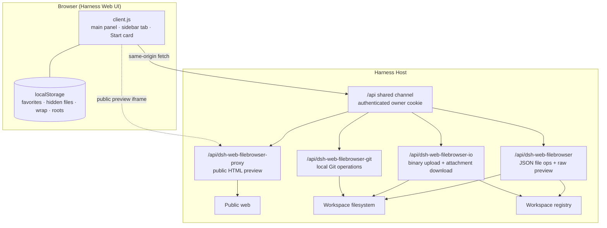

# DeepSeek Harness Web Dev Workspace

A VS Code-style workspace for the **DeepSeek Harness** Web UI:
browse, edit and search workspace files, run Git, terminal and browser tasks,
and keep the floating conversation, Agent actions and workspace memory in one
place — without leaving the chat.

**[Install](#installation)** · [Highlights](#highlights) · [Features](#features) · [Usage](#usage) · [How it works](#how-it-works) · [Development](#development) · [中文文档](README.zh.md)

  

---

Dev Workspace turns the Harness Web UI into a practical coding workspace. It adds
the workspace to the left sidebar and the right sidebar's Start page, while keeping
the chat and the sessions exactly where they are.

It is one **local combined bundle**, not an npm package: install the repository
root once through the Harness Plugin Manager, or ask the Harness agent to install
it for you.

## Contents

- [Highlights](#highlights)
- [Features](#features)
- [Installation](#installation)
- [Usage](#usage)
- [How it works](#how-it-works)
- [Security and privacy](#security-and-privacy)
- [Compatibility and limitations](#compatibility-and-limitations)
- [Repository layout](#repository-layout)
- [Development](#development)
- [Contributing](#contributing)
- [License](#license)

## Highlights

- **A real editor inside the chat UI** — tabs, syntax highlighting, line numbers,
  a word-wrap toggle, find/replace, save and one-click copy-all.
- **Files, not just previews** — create, rename, move, copy, delete, upload and
  download; drag files in from the OS; save with stale-file protection.
- **Search and Quick Open** — workspace-wide content search, a `Ctrl/⌘ + P` file
  picker and a `Ctrl/⌘ + Shift + P` command palette.
- **Markdown, PDF and image previews** — rendered Markdown with a live split view,
  inline PDF/images, and a browser handoff for binaries.
- **Local Git workflow** — changes and commit graph, staging, commits, restore,
  stash, branch switching, diffs, compare and fetch/pull/push; the bottom Git tab
  shows an amber badge with the number of uncommitted files.
- **Built-in terminal** — vendored xterm.js terminals that move between the bottom
  panel and editor tabs, with manual project quick commands for local workspaces
  and interactive remote shells over ssh2 for SSH workspaces.
- **Built-in browser** — preview a running dev server beside the code, with
  PC/mobile viewports, workspace-stored address bookmarks, protocol/host settings
  and a public-page proxy fallback.
- **Workspace fullscreen** — fill the real browser viewport with the whole
  workspace (explorer, tabs, editor/browser and terminal), on desktop and mobile.
- **Favorites and a workspace switcher** — one click opens a favorite file or
  folder; remove stale workspace records from the picker.
- **Floating DeepSeek chat** — keep the current conversation in a movable,
  resizable, collapsible panel while the file workspace is maximized.
- **Agent collaboration** — send a selection to the conversation to explain, fix
  or write tests; nothing is sent until you choose an action.
- **SSH remote folders** — browse and edit a remote directory over SFTP using the
  Host's SSH agent, keys or a one-time password.
- **Cross-session workspace memory** — each workspace keeps durable notes shared
  by every chat session in that workspace and injected automatically.
- **Workspace todo list** — per-workspace tasks with priority, due dates, tags,
  notes, filters and sorting, also available to the model.
- **Tasks and retest** — the Tasks sidebar view detects build/test/lint/dev
  commands, runs them with streamed output and exit codes, and turns errors in
  the output into clickable file:line links that jump into the editor. Tasks that
  were still running when the page reloaded are re-attached.
- **Acceptance board and delivery** — the Acceptance sidebar view keeps a
  `.dsh/acceptance.json` checklist (pending / pass / fail / blocked plus notes),
  exports a Markdown acceptance report, and sends failed items back to the agent;
  the Git changes list gains per-file **reviewed** marks; for delivery you can
  download a build-output ZIP or pack the report plus build output into
  `.dsh/deliveries/`; screenshots and other evidence upload to `.dsh/evidence/`
  and attach to the selected acceptance item note; each packed bundle is recorded
  in `.dsh/deliveries.json` and can be downloaded again from the panel; a
  running dev-server port can be shared as a tokenised preview link for phones
  and clients on the same network.
- **Fits the host** — theme-token styling, English/Chinese copy, a compact
  single-column layout in narrow sidebars, a right-sidebar Start card, and a
  mobile/tablet layout.

## Features

### Explorer and workspace management

- Browse every registered Harness workspace; switch from the header picker.
- The explorer header has a **side switch** that moves the file tree to the left or
  right of the editor; the choice is persisted and the splitter drag direction
  follows it.
- Create files/folders, rename inline (F2), delete with confirmation, refresh.
- **Copy / cut / paste** files and folders between directories from the context menu,
  or drag a tree entry onto a folder to move it. The context menu can also copy a
  file or folder's relative or absolute path.
- Drag files from the OS onto the tree or a folder to upload them; duplicate names
  are resolved automatically (128 MiB per file).
- Single-click a file to open it; single-click a folder to select it, double-click
  a folder (or its chevron) to expand/collapse.
- Explorer rows follow VS Code: when an expanded folder contains exactly one
  subfolder and that subfolder is expanded too, the chain collapses into one
  `parent/child/grandchild` row; an expanded empty folder shows no placeholder.
- The explorer header has one-click buttons for **collapse all**,
  **show/hide hidden files**, **go to workspace root**, and refresh.
- **Favorites** per workspace: right-click an entry or use the star in the
  Favorites header; single-click a favorite to open/jump. Favorites follow renames
  and deletions and are persisted in `localStorage`.
- **Workspace picker**: switch roots, see each workspace's full path, and remove a
  single record with the row's trash button. Registered workspaces are removed
  from the Harness Workspace registry (files and sessions are preserved); a
  directory that is only the deployment default is hidden locally.
- **Path address bar**: type a relative path (`src/lib`, `./README.md`) to reveal
  and open it; type an absolute directory outside the current root to register or
  resolve it as a workspace and switch to it. Absolute paths inside the current
  root are located in the tree. `Enter` goes, `Escape` clears.
- **Go to workspace root** from the Home button or `Alt+Home` inside the panel.

### Search, Quick Open and Harness

- **Workspace search**: the Search sidebar tab searches file contents with optional
  case sensitivity and regular expressions. Results are grouped by file and jump to
  the matching line. It skips `node_modules`, `.git`, `dist` and similar directories,
  caps each file at 2 MiB and limits the result count. SSH workspaces do not support
  global search yet.
- **Quick Open**: `Ctrl/⌘ + P` filters workspace files by name. `Ctrl/⌘ + Shift + P`
  opens the command palette for new file/folder, search, refresh, terminal, browser,
  memory, todo and Harness actions.
- **Auto refresh**: local workspaces watch their expanded directories through a Host
  long poll (falling back to a five-second pass when the Host lacks the route), so
  external creates, deletes and renames show up almost immediately. Open text tabs
  are checked every five seconds too: a clean tab reloads automatically when its
  file changes on disk, and a dirty tab offers **Reload** or **Keep my changes**.
- **In-file find/replace**: `Ctrl/⌘ + F` opens the editor find bar with next/previous,
  case sensitivity, replace and replace all.
- **Harness panel**: a small icon in the header action cluster (between the
  browser and maximize buttons) opens the Harness info panel, which shows the
  active profile, plugin version, bundles, dependencies and profile config files.
  It can preview `cordis.yml`, `cordis.patch.yml` and `package.json`, and run the
  plugin's `npm run check`. The panel takes no sidebar view tab: clicking the icon
  again (or the × in its title bar) returns to the previous view, and the command
  palette opens it too.

### Cross-session workspace memory

- Every **local workspace** keeps an independent memory document at
  `.dsh/memory.json`. All chat sessions running in that workspace read and write
  the same notes; another workspace never sees them. An ungrouped session uses its
  recorded working directory as the scope.
- The model gets `memory_save`, `memory_search`, `memory_update` and
  `memory_delete` tools plus a short system-prompt guide. Existing notes are
  injected automatically as `workspace-memory` context (bounded to 4,000
  characters), so a new session starts with decisions, conventions and
  environment facts that earlier sessions saved.
- The **Memory** sidebar tab lists entries with tags and timestamps and lets you
  add, edit and delete them without leaving the workspace. The panel and the
  model tools share the same store, so an edit is visible to the next request.
- The first write creates `.dsh/.gitignore` containing `*` when it is absent,
  keeping plugin state out of Git by default. The JSON document can also be
  reviewed or edited by hand; a corrupt document is reported instead of silently
  discarded.
- Limits: 200 entries per workspace, 4,000 characters per entry, 8 tags per
  entry. SSH remote roots and profiles without the `tools` / `systemPrompt`
  services have no memory support.

### Workspace todo list

- Every **local workspace** keeps its tasks in `.dsh/todos.json`. The **Todo**
  sidebar tab and the model tools share that document, and switching workspaces
  switches the board.
- Quick-add from the input (press Enter); set a priority (low/normal/high/urgent),
  due date and tags while adding. Each task can be checked off, reopened, edited
  inline (title, note, priority, due, tags), deleted, or cleared in bulk once done.
- The header shows open/done counts, a completion bar and the overdue count. Due
  dates display as **overdue by N days**, **due today** or **due tomorrow** as
  appropriate. Filter by open/done/all, search titles, notes and tags, and sort by
  priority, due date, last update or creation time; filter/sort choices persist.
- The model gets `todo_list`, `todo_add`, `todo_update` and `todo_delete` tools
  plus a short prompt guide. These are separate from Harness's session-scoped
  `todo_write` plan tool: they manage the user's persistent workspace board.
- While the panel is visible it re-reads the document every eight seconds and on
  window focus (not during an inline edit), so model or external edits appear
  promptly. Writes use a temp-file rename under a per-root lock so the panel and
  a tool call cannot overwrite each other.
- The first write creates `.dsh/.gitignore` containing `*` when absent. Limits:
  500 tasks per workspace, 500 characters per title, 4,000 per note and 8 tags per
  task. SSH remote roots have no local todos; without the `tools` / `systemPrompt`
  services the panel still works but the model tools stay off.

### Editor

- Multi-tab editing with dirty indicators, close confirmation, unsaved buffers
  retained while switching panels.
- Save with `⌘/Ctrl+S` or the Save button; reload; stale-file detection with
  Reload/Overwrite choices.
- Syntax highlighting for JavaScript/TypeScript, JSON, CSS, HTML/XML, Python,
  Shell, YAML, SQL, Markdown, Rust, Go, Java, Kotlin, Scala, Swift, Dart, Groovy, C#,
  C/C++, Objective-C, Ruby, PHP, Lua, R, Perl, PowerShell, F#, VB.NET, Razor,
  Protocol Buffers, GraphQL, Terraform, CMake, Dockerfile, Makefile, config files,
  and diffs.
- Line numbers, `Tab` indentation, basic auto-indent, and a draggable explorer
  width.
- Word-wrap toggle (remembered, labeled) and **copy all** of the active buffer.
- Markdown preview with headings, lists, tables, fenced code, links and relative
  images; switch between preview, edit and **split** view. Split puts the editor on
  the left and live preview on the right with a draggable divider, and stacks on
  narrow panels.

### Previews and transfer

- PDF preview in an embedded viewer with an "open in browser" action.
- Inline image preview for PNG/JPEG/GIF/WebP/AVIF/BMP/ICO/SVG.
- Binary and unreadable files offer a download button plus a browser handoff.
- Upload multiple files from the machine into the selected directory (Explorer
  toolbar or right-click "Upload files here"). Same-name uploads are auto-renamed
  to `name (1).ext`, `name (2).ext`, ...; a single uploaded file opens
  automatically, while multiple files are selected in the tree. Limit:
  **128 MiB per file**.
- Download any open file (editor toolbar or right-click "Download file"). The
  companion route sends `Content-Disposition: attachment`, so PDFs and images are
  saved instead of previewed.

### Integration

- **Left sidebar** panel icon opens the full workspace in the centre column.
- **Right sidebar Start page** gets a third "Dev Workspace" card next to
  "Workspace files" and "New terminal"; picking it opens the same workspace as a
  right-sidebar tab.
- Narrow sidebars switch to a compact single-column layout: the explorer first,
  then the editor with a back button in the breadcrumb.
- English and Chinese UI; the client uses only Harness theme tokens (`--dsw-*`) and
  imports no Harness Client package.
- Sidebar tabs include **Explorer / Search / Todo / Git / Memory**; the
  Todo tab shows the number of open tasks, and Git shows an amber changed-file
  count while the worktree is dirty. The strip collapses labels to icons and then
  to a **More views** menu as it narrows, so adding views does not crowd it. The
  rarely used **Harness** info panel takes no tab at all: a small header icon
  opens it.
- **Mobile/tablet layout**: below a 900px panel width the explorer and editor switch to
  a single-column layout with a back button in the breadcrumb; the header wraps with a
  full-width address row; tree rows, sidebar tabs and action buttons get larger touch
  targets; Markdown split stacks vertically; terminal quick commands, search, Harness,
  modals and the command palette all fit narrow screens.
- Registers only the workspace-memory and todo tools with their prompt guides; no
  general-purpose tools or session events.

### Git source control

- A **Git** tab at the bottom of the sidebar switches between the file tree and a
  source-control view for the selected workspace. Inside Git, **Changes** and
  **Commit graph** are separate views.
- Shows the current branch, upstream, ahead/behind counts, unborn/detached state,
  staged changes, working-tree changes and untracked files.
- The commit graph renders Git lanes for all refs (including branches and merges);
  click a commit to see its changed files and click a file for that commit's diff.
- Stage/unstage individual files or everything, write a commit message and commit
  (`Ctrl/⌘+Enter`); diff any changed or untracked text file in a read-only editor
  tab that defaults to a centered side-by-side view; one horizontal scrollbar at
  the bottom pans both sides together, and the view can switch to unified.
- Initialize a repository when the workspace is not one, and switch between local
  branches from a branch picker.
- **Restore** a changed file (or **Restore all** changes) after a confirmation;
  tracked files return to the index or `HEAD`, while untracked files are deleted.
- A **Stash** toolbar button saves the current changes with an optional message
  (and optionally untracked files), then lists stashes with **Apply**, **Pop** and
  **Drop**. A conflicting apply keeps the stash entry and reports the conflict.
- A toolbar adds **Fetch / Pull / Push / Compare**: fetch refreshes remote refs,
  pull is fast-forward only, push sets `origin/<branch>` as upstream on its first
  run, and **Commit & push** chains both.
- **Compare** one branch against upstream, a local branch or a remote branch:
  commits unique to each side, ahead/behind counts, and files changed since the
  merge base, each opening as a diff against the base.
- Remote operations use only the Host's existing SSH key or Git credential helper;
  the plugin never collects or stores credentials and fails instead of prompting.
  Pulls never merge or rebase automatically and pushes never force.
- The Git view requires the workspace to be the repository **root**; opening a
  subdirectory of a larger repository shows a hint instead of staging outside it.


### Floating conversation

- The **chat button** in the panel header opens the current Session's DeepSeek
  conversation as a movable, resizable floating panel. It works both when the
  file workspace fills the main column and when it runs in the right Sidebar.
- The panel uses the real Conversation surface for the on-screen Session, so
  messages, streaming output, drafts and attachments stay in sync with the main
  chat. Drag its header to move it, resize from the corner, collapse it to its
  title bar with the chevron, or close it from its header.
- The **+** button creates a new Session in the current workspace and shows it in
  the same floating panel without leaving the file workspace. The new Session is
  added to the normal Session list; SSH workspaces keep the button disabled.
- The title-bar selector lists other Sessions in the same workspace. Choosing one
  switches the floating panel to that conversation; **Current conversation**
  returns to the Session selected in the main UI.
- Floating panels remain visible when the explorer is maximized, so the file
  workspace can fill the panel while the conversation stays focused. A collapsed
  panel keeps its title bar in place and can be expanded again with one click.
- In a **mobile/tablet browser** (UA-detected) the floating conversation becomes a
  full-screen sheet: drag/resize controls are hidden, while session selection,
  new-chat and close actions remain, with safe-area padding. A narrow desktop
  window keeps the normal floating panel.

### Agent collaboration

- The editor toolbar has an **Agent** button. With code selected it can **Explain
  selection**, **Fix selection** or **Write tests for selection**; without a
  selection, **Explain this file** uses the whole buffer.
- The action builds a prompt from the path, line range and code, then sends it to
  the current floating conversation (opening the panel if needed). Nothing is
  written back automatically; you decide whether to apply a suggestion.
- Explain/Fix/Tests are disabled without a selection. Failed or timed-out sends
  show a toast.
- This is explicit: code reaches the model only after you click an action; opening
  or browsing files does not send anything.

### Built-in terminal

- Use the header **terminal button**, the welcome page's **Open terminal** action, or `Ctrl/⌘ + backtick` to show the bottom terminal panel; drag its top edge to resize.
- A terminal can live either in the bottom panel or the editor. The panel header has **Open in editor**; an editor terminal's toolbar has **Move to panel**.
- Rendering uses vendored xterm.js. On Linux the Host opens a `script(1)` PTY (util-linux `script` is required), so interactive Bash, colours, `Ctrl+C` and full-screen programs work. On Windows the system command processor (`cmd.exe`) runs over pipes because `script(1)`/`/dev/pts` do not exist there; simple line-buffered commands work (with local echo/backspace), while full-screen programs, terminal resizing and signal keys such as `Ctrl+C` are limited.
- Local terminals start in the workspace root and run arbitrary commands as the
  Harness host user; only the owner can reach them. Output buffers are capped at
  about 1 MB and up to 8 terminals can be open.
- **SSH terminals**: opening a terminal in an `ssh://user@host:port/path`
  workspace makes the Host request a remote PTY and start the login shell over
  the ssh2 connection the file panel already pooled, in the remote workspace
  root. Input, output, `Ctrl+C`, window resizing (`window-change`) and close
  behave like the local PTY. The connection is shared with file operations, so a
  password entered in the SSH connect dialog is reused without being written to
  disk; after the connection drops or DSH restarts, reconnect the SSH workspace
  in the file panel. The remote side is expected to be a POSIX shell (`$SHELL
  -l` is executed). SSH terminals do not detect project quick commands (the bar
  shows an **SSH terminal** label) but the command input still works, and the
  status bar says SSH terminal instead of local terminal.
- Output is pushed by a Host-side long poll: the request answers as soon as the
  shell writes, so keystroke echo and command output are not delayed by a fixed
  polling interval; an idle terminal costs about one heartbeat request per
  second, and output that arrives in tiny chunks is briefly coalesced before it
  is rendered.
- A **Quick commands** bar above each terminal can detect runnable project commands:
  `package.json` scripts such as `npm run dev`, Maven/Gradle, `java -jar`,
  `dotnet`, Django, Go, Cargo and Docker Compose. Pick a command, edit it if needed,
  and press **Run**; the input also accepts arbitrary commands. Only two things
  fill the list: the refresh button (manual, forces a rescan) and the one-off
  check after `cd` / `pushd` / `popd`; opening a terminal detects nothing, and
  the timer, window-focus and tab-visibility refreshes are gone. On Linux the
  check follows the shell cwd read from `/proc`. The Host still caches the list
  for 30 seconds, so manual refreshes do not rescan the project repeatedly.
  Recursive `.jar` / `.dll` discovery only runs in Java or .NET projects.

### Built-in browser

- Open a browser tab from the **globe button** in the panel header, the
  **Built-in browser** action on the welcome page, or `Alt+B`.
- The address bar accepts `localhost:5173`, `:3000`, `https://example.com` and
  similar; back, forward, reload and external-open are built in.
- The toolbar star **bookmarks the current address** together with the active
  **PC / Mobile** viewport (device preset and orientation); click the filled star
  again to remove it. The start page lists every bookmark and reopens one in its
  saved viewport with a single click, and each row can be deleted there after a
  confirmation. The
  pencil button beside a row edits its **alias** (Enter/Save persists it, Escape
  cancels; an empty alias restores the automatic `host+path` name).
  Bookmarks and the start page's **Protocol / Host** fields are stored per
  workspace in `.dsh/browser-bookmarks.json` and kept out of Git by the generated
  `.dsh/.gitignore`, so the port shortcuts survive reloads, a browser-data wipe or
  a different Harness origin without ever being committed.
- An HTTPS mixed-content warning can be dismissed; it hides itself after three
  seconds and returns after a reload, navigation or Direct/Proxy switch.
- The **Maximize editor** button at the panel's top-right hides the explorer so
  the editor/built-in browser fills the file-workspace component itself; press Esc
  or click Restore to bring the tree back.
- The adjacent **fullscreen** button makes the whole workspace fill the real
  browser viewport, keeping the explorer, tabs, browser/editor and terminal
  available. It uses the native Fullscreen API when available and a fixed-position
  fallback otherwise, so it also works on phones and tablets (safe-area insets are
  respected). Press Esc or the exit-fullscreen button to leave.
- The toolbar switches between **PC** and **Mobile** viewports. Mobile offers
  iPhone 14 / iPhone SE / Pixel 7 / iPad presets plus portrait-landscape rotation,
  scaled to fit the panel. Only the CSS viewport is emulated (no touch events or
  User-Agent), so use browser DevTools for full mobile emulation.
- The start page reads listening Host ports (Linux `/proc/net/tcp`), can rescan,
  and offers one-click local dev-server links; other platforms show common ports.
  **Protocol** (Auto, HTTP or HTTPS) and **Host** fields apply to every port
  shortcut (default Auto + `localhost`, persisted).
- Local dev servers and private addresses are embedded directly in a sandboxed
  `iframe`; the Harness origin itself is never embedded.
- Public pages load directly by default, which keeps cookies, modules and SPAs
  working. If a site refuses framing, switch the toolbar control from **Direct**
  to **Proxy**: the Host fetches the HTML, strips `X-Frame-Options`/CSP frame
  restrictions and injects a `<base>` plus a small link/form bridge. The proxy
  forwards no cookies/login state, so authenticated or module-heavy SPAs may
  render incompletely; use the external browser then.
- The proxy only accepts public `http/https` addresses, rejects loopback/private
  IPs, follows at most five redirects and caps pages at 8 MB. Local/private URLs
  always stay direct.
- Port scanning returns port numbers only (no process command lines) over the same
  owner-authenticated API.
- This is a restricted preview, not a full browser: direct local iframes cannot
  sync their internal navigation to the address bar, and complex public pages may
  not work. Use the external browser for full navigation or login.

### SSH remote folders

- Add a remote directory from the **Add SSH remote…** entry at the bottom of the
  workspace picker, or type `ssh://user@host:22/absolute/path` in the address bar.
  Remote roots participate in switching, favorites and recent-root behavior like
  local ones.
- Browse, open/save text files, create, rename, delete, copy/move and
  upload/download over SFTP; drag-and-drop upload works for remote roots too.
- Authentication uses the SSH agent or keys under `~/.ssh` (HostName, User, Port
  and IdentityFile from `~/.ssh/config` are honored). A password can also be
  entered for a single connection; it is never written to disk and must be
  re-entered after the connection drops.
- SSH support requires `ssh2`: run `npm install` once at the repository root.
  Without it every other feature still works; SSH operations report the missing
  dependency.
- Remote workspaces can also open a terminal: it reuses this SSH connection to
  start a login shell on the remote host (see **Built-in terminal**), so the
  password or key is only supplied when the connection is established.
- **Host keys are not pinned** (ssh2 accepts the key presented at connect time).
  Only use remote folders on trusted hosts and networks.
- Git is local-only: the Git tab is hidden for SSH roots.

### Snapshot Preview

  
  
  
  
  
  

## Installation

### Requirements

- A DeepSeek Harness installation with the **Web** profile and the **Plugin
  Manager** page (shipped with the standard Web app).
- Tested with DeepSeek Harness **`0.2.1-rc.2`** on **Linux**. Later releases may
  work, but the slot/service APIs are not guaranteed to be stable between
  releases; macOS/Windows hosts are not explicitly verified.
- No build step. The bundles are plain ESM and run
  inside the Harness host.
- A current evergreen browser (the UI uses `color-mix`, `ResizeObserver`, and the
  Clipboard API).
- For SSH remote folders: `npm install` at the repository root (installs `ssh2`)
  and a configured SSH agent or key under `~/.ssh`.
- For Git features: `git` on the Harness host's `PATH`, and a configured Git
  identity for commits (`user.name` / `user.email`).

The repository is now one **combined bundle** (`@local/dsh-web-dev-workspace`) with three internal components; install the repository root once:

| Directory | Purpose |
| --- | --- |
| `dsh-web-filebrowser-plugin/` | Main component: Host file API, SSH/SFTP and the browser explorer/editor UI. |
| `dsh-web-filebrowser-io/` | Host-only component: binary upload and forced-download routes. |
| `dsh-web-filebrowser-git/` | Host-only component: Git status, stage, commit, restore, stash, diff, branches, compare and fetch/pull/push. |

### Install from a local checkout

1. Clone the repository (or download and extract a release):

   ```bash
   git clone <repository-url> dsh-web-filebrowser
   cd dsh-web-filebrowser
   ```

2. For SSH remote folders, install the optional dependency at the repository root:

   ```bash
   npm install
   ```

3. In the Harness Web UI, open **Plugins** in the left sidebar.

4. Choose **Add plugin** → **Install a third-party plugin**, and enter the
   **absolute** path to the **repository root**:

   ```text
   /absolute/path/to/dsh-web-filebrowser
   ```

   Confirm the trust prompt, install, then **Enable now**.

5. Refresh the page if the entries are not visible. Because the combined bundle
   also starts Host-side components, restart Harness once if the Plugin Manager
   asks for it.

> **Why one install?** The root `cordis.patch.yml` starts the explorer/editor,
> binary I/O and Git components together on the same authenticated `/api`
> channel. The three subdirectories remain independently installable for
> development.

### Install through the Harness agent

If you are working with the DSH agent, ask it to install the combined local
bundle:

```text
Install the local DSH bundle at /absolute/path/to/dsh-web-filebrowser and enable it.
```

The agent uses the same Plugin Manager installation path as the UI (the
repository root, not a subdirectory).

### Update and uninstall

- **Upgrading from `dsh-side`**: uninstall the old `@local/dsh-side` bundle and its
  two companions, then install the repository root again. Root, favorites,
  preferences and SSH remotes are copied from the old `dsh-side:` browser keys on
  first load. Hard-refresh any tab opened with the old client.
- **Version hint**: the file workspace header shows the current version (for
  example `v1.2.7`). Clicking the badge checks `taskkill/dsh-web-dev-workspace`'s
  `package.json` on GitHub and highlights a newer version with update guidance.
  The result is cached in Host memory for six hours; the check requests only the
  public version manifest and sends no workspace data. The hint compares the
  `version` field, so publish a version bump with each release. Repository:
  https://github.com/taskkill/dsh-web-dev-workspace. The update dialog also offers
  **Update now**: it only runs `git pull --ff-only` in a clean checkout, refuses
  local changes, shows the output, and asks for a DSH restart; it never restarts
  the Host process silently.
- **Update**: in **Plugins → Installed plugins**, uninstall and reinstall the
  combined bundle from the updated local path (or use the UI's update action when
  it is offered). A local-patch development copy can be updated with `git pull`
  followed by a DSH restart.
- **Commands shown by the update prompt** (copyable from the dialog):

  ```bash
  # Local checkout: pull, then restart DSH
  git pull

  # Plugin manager: install the latest GitHub build
  dsh plugin --profile web add github:taskkill/dsh-web-dev-workspace
  ```
- **Uninstall**: uninstall `@local/dsh-web-dev-workspace` from **Installed plugins**. This removes
  the profile dependency/link and the plugin row; it does not delete your cloned
  source or workspace files.
- **Browser state**: view preferences and file favorites live in the browser's
  `localStorage`; preview-address bookmarks live in each workspace's
  `.dsh/browser-bookmarks.json` (git-ignored). Uninstalling the plugin does not
  clear either; use your browser's site-data controls for the former, or delete
  the `.dsh` file for the latter.

### Troubleshooting

| Symptom | What to try |
| --- | --- |
| No new sidebar icon / Start card | Refresh the page. Confirm the combined bundle is enabled in **Plugins**. |
| Upload or download fails | Confirm the combined bundle `@local/dsh-web-dev-workspace` is installed and enabled. |
| Git view says support is not installed | Confirm the combined bundle is enabled; SSH remote workspaces have no Git view. |
| Git view says not the repository root | Open the repository root itself as the workspace; Git mutations are confined to that root. |
| Fetch/pull/push says the remote requires authentication | Configure an SSH key or Git credential helper on the Host; the plugin never prompts for or stores credentials. |
| Pull reports that branches diverged | Pull is fast-forward only; rebase or merge the branch in a terminal, then pull again. |
| Push is rejected as non-fast-forward | The remote has new commits; fetch and pull (or merge), then push. |
| Network buttons are disabled | The repository has no remote, or the branch has no upstream (Pull). |
| Commit fails with identity unknown | Configure `user.name` and `user.email` on the Harness host. |
| "只能访问已注册的工作区目录" / "outside-root" | Open the directory once through the address bar so it is registered as a workspace, then retry. |
| Install rejected (for example, no composite bundle declared) | Install the **repository root** absolute path; its `package.json` must declare `dsh.bundle` and `cordis.patch.yml` must exist. Do not install a subdirectory for the full feature set. |
| A change is not live | Client-side changes use the browser HMR path; Host-side changes require a Harness restart, as reported by the Plugin Manager. |

## Usage

### Open the workspace

1. Click the new workspace icon in the left sidebar, **or** open the right
   sidebar's Start page and pick **Dev Workspace**.
2. Pick a workspace in the header, or type a path in the address bar.
   Opening the code workspace from a workspace session first selects that
   session's workspace; after a manual workspace switch, the explorer respects
   your choice instead of following later session changes.

### Keyboard shortcuts

| Shortcut | Action |
| --- | --- |
| `⌘/Ctrl + S` | Save the active file |
| `F2` | Rename the selected file/folder |
| `Ctrl/⌘ + C` | Copy the selected entry |
| `Ctrl/⌘ + X` | Cut the selected entry |
| `Ctrl/⌘ + V` | Paste into the selected folder (or its parent) |
| `Delete` | Delete the selected file/folder |
| `Enter` | Open the selected file / toggle the selected folder |
| `←` / `→` | Collapse/expand the focused folder |
| `Alt + Home` | Jump to the current workspace root |
| `Alt + B` | Open a built-in browser tab |
| `Ctrl/⌘ + backtick` | Show/hide the bottom terminal panel |
| `Ctrl/⌘ + Enter` | Commit staged changes from the Git message box |
| `Ctrl/⌘ + P` | Quick Open a file |
| `Ctrl/⌘ + Shift + P` | Open the command palette |
| `Ctrl/⌘ + Shift + F` | Open workspace search |
| `Ctrl/⌘ + F` | Find/replace inside the editor |
| `Escape` | Close a menu/modal or clear the address input |

### Address bar examples

| Input | Result |
| --- | --- |
| `src/lib` | Expand and select `src/lib` in the tree |
| `./README.md` | Open `README.md` in the editor |
| `/data/projects/app` | Register/resolve the directory as a workspace and open it |
| `/data/projects/app/src` (inside the current root) | Locate `src` in the current tree instead of resetting the workspace |

### Workspaces, hidden files and favorites

- **Hidden files**: dotfiles are hidden by default. Use the eye button in the
  explorer header to toggle; the choice is remembered. Creating or navigating to
  a dot path enables it automatically.
- **Favorites**: right-click a file/folder or use the star in the Favorites
  header. Single-click a favorite to open the file or jump to the folder.
- **Remove a workspace record**: open the workspace picker, hover a row, and click
  the trash button. Removing a registered workspace removes its registration from
  the Harness workspace list; it does **not** delete files, and sessions remain
  (they are simply no longer grouped under that workspace).
- **Go to root**: the Home button in the explorer header (or the main header), or
  `Alt+Home`.

### Git workflow

1. Click the **Git** tab at the bottom of the sidebar. The file tree is replaced
   by the source-control view; click **Explorer** to return. Inside Git, switch
   between **Changes** and **Commit graph**; click a commit to expand its files
   and a file to open that commit's diff.
2. If the workspace is not a repository, choose **Initialize repository**. If it
   is a subdirectory of a larger repository, open the repository root instead.
3. Use **+** on a changed file to stage it, or **Stage all**; use **−** / **Unstage
   all** in the staged section to reverse it. The restore icon on a row (or
   **Restore all** above the changes) discards changes after a confirmation;
   untracked files are deleted.
4. Type a commit message and click **Commit** (or press `Ctrl/⌘+Enter`). The
   list refreshes after a successful commit. **Commit & push** commits and pushes
   in one step.
5. Click a file row to open a read-only side-by-side diff in the editor area. The
   divider stays centered; drag the single horizontal scrollbar at the bottom to
   pan both sides together, or switch to **Unified** in the diff toolbar. The
   **Open file** action loads the working tree file in a normal editor tab.
6. Click the branch button to list local branches and switch to one.
7. **Fetch** updates remote refs (`git fetch --prune`); **Pull** fast-forwards
   from the upstream and explains how to proceed when the branches diverge;
   **Push** publishes the current branch and sets `origin/<branch>` as upstream on
   the first push.
8. **Compare** opens a base picker: it lists commits unique to each side,
   ahead/behind counts, and files changed since the merge base; click a file for
   its diff against the base.
9. **Stash** opens the stash dialog: save current changes with an optional message
   and **Include untracked files**, then **Apply** (keep the entry), **Pop** (apply
   and remove it) or **Drop** an existing stash. Applying a conflicting stash keeps
   the entry so no work is lost.

Pulls are fast-forward only, pushes never force, and neither resolves conflicts.
Network commands run with `GIT_TERMINAL_PROMPT=0`, never read or store
credentials, and rely on the Host's SSH key or credential helper. Commits and
pushes run the repository's configured hooks, so only operate in repositories you
trust.

## How it works



- The browser half registers `main` key `files`, a `sidebar.panellist` entry and
  a `ctx.sidebarRightTabs` type (`kind: dsh-web-filebrowser`) with body/title seats.
- The Host half registers exact `/api` routes through
  `ctx.connection.fetch.register`. Only owner peers reach an exact route, so the
  browser's signed session cookie is the authentication input; the plugin does
  not mint a token.
- Every path is resolved and checked inside the selected root; symlinks are
  resolved before the containment check. The root itself cannot be renamed or
  deleted through the plugin. File mutations use Node's filesystem APIs because
  the shipped `workspaceFiles` Remote namespace is read-only.
- Uploads are written with `wx` and auto-renamed on collision. Downloads are
  streamed with `Content-Disposition: attachment`.
- The Git companion shells out with `execFile('git', args)` (never through a
  shell), requires the workspace to be the repository root, and validates paths
  before passing them after `--`. It does not run network commands.

## Security and privacy

Dev Workspace is a **local-first** plugin with filesystem access. Review the source
before enabling it, and only install bundles you trust. To report a
vulnerability, follow [`SECURITY.md`](SECURITY.md) — please do not open a public
issue for security-sensitive reports.

- **Authentication**: the `/api` exact routes are reachable only by the owner
  browser with a valid Harness session cookie; no extra token or unauthenticated
  port is introduced.
- **Confinement**: all reads and writes are confined to a registered workspace
  root (or the deployment default directory). Paths are split into segments,
  `..` is rejected, and symlinks are resolved before containment is checked.
- **No telemetry**: no analytics, tracking, or hardcoded external endpoints.
  External links/images inside a Markdown file are loaded only when you preview
  that file; images use `referrerPolicy="no-referrer"` so the Harness page URL is
  not sent to the third-party host.
- **Model-visible workspace data is explicit and scoped**: the plugin registers four
  workspace-memory tools, four todo tools and two short prompt guides. Only the
  current workspace's notes (bounded) are injected into its sessions; the todo
  board is not injected and is read on demand via `todo_list`. It registers no
  general-purpose tools or session events. Opening, searching or browsing files
  still adds nothing to the conversation; only an explicit **Agent** action sends
  the selected code and path as a user message. Memory and todos never cross
  workspace boundaries, and deleting `.dsh/memory.json` or `.dsh/todos.json`
  removes them. Memory content is sent to the model on every request in that
  workspace, so do not store secrets there; the prompt tells the model the same.
- **SSH remote folders**: authentication uses the Host's SSH agent or keys under
  `~/.ssh`, and optionally a password supplied for one connection. That password
  lives only in the request/connection in memory, is never written to disk, and
  expires when the connection drops. `ssh2` accepts the host key presented at
  connect time (no known_hosts pinning), so use trusted hosts and networks only.
- **Git network operations are explicit**: fetch/pull/push only touch remotes the
  repository already configures; pull is fast-forward only, push never forces, no
  automatic merge/rebase runs, and no credential is stored. **Restore** deletes
  untracked files and resets staged/worktree changes after confirmation; stashes
  can be dropped, so review the target before confirming. Git runs inside the
  selected repository, whose local config, hooks (commit/push) or fsmonitor can
  execute code; only use Git in repositories you trust.
- **Limits**: editor text reads 8 MiB; raw previews 128 MiB; uploads 128 MiB per
  file.
- **Filesystem permissions**: the plugin runs with the Harness host's filesystem
  permissions. Removing a workspace registration does not delete any file.

## Compatibility and limitations

- **No build and no npm publication**: the packages use the `@local/` scope and are
  intended to be installed as a local combined bundle. Rename the packages if you want to
  publish your own fork to a registry.
- **No folder upload/download**: only individual files are transferred. Upload a
  folder by creating it in the UI and uploading its files, or zip it externally.
- **Auto refresh is local-only**: expanded local directories and open text files are
  polled every five seconds; SSH roots are not polled. Clean tabs reload
  automatically, while tabs with unsaved edits prompt before discarding changes.
  Saves use stale-file protection.
- **Todos are local-only**: tasks live in `.dsh/todos.json`; SSH remote roots show
  an explanation instead of an editor. The panel refreshes every eight seconds
  while visible and pauses that refresh during an inline edit.
- **No automatic merge/rebase or hunk staging**: search and Quick Open currently
  support local workspaces only; use the tree for SSH roots. A diverged pull only
  reports the condition; resolve it in a terminal first.
- **Git network operations require preconfigured authentication** on the Host (SSH
  key or credential helper); the plugin cannot prompt for a username or password.
- **Git requires the workspace root to be the repository root**; repositories
  whose top level is a parent directory are not supported for mutations.
- **One active root per view**: multiple workspaces are available through the
  picker, but the tree shows the selected root.
- **No binary editing**: binary files are previewed (images/PDF) or handed to the
  browser.
- **Preview sharing**: a share link is a token-prefixed reverse proxy on its own
  random Host port (bound to `0.0.0.0` by default); public access requires that
  port to be reachable. Only HTML is rewritten, so front-end code that builds
  absolute URLs in JavaScript needs a matching dev-server `base`.
- **Host API stability**: built against the `0.2.1-rc.2` Harness package APIs. A
  future Harness release may require updates to the slot/service contracts.

## Roadmap

The next stage aims at developing complete projects with the Harness chat plus
this plugin only: a run-and-diagnose loop, agent change review, session recovery,
Git completion, an editor foundation, LSP and browser verification. Priorities,
integration points, costs and acceptance criteria live in
[docs/ROADMAP.md](docs/ROADMAP.md); the batch 0–3 retest steps live in
[docs/ACCEPTANCE.md](docs/ACCEPTANCE.md).

## Repository layout

```text
dsh-web-filebrowser/
├── index.js                  # combined bundle entry: files, IO, Git
├── cordis.patch.yml          # combined bundle row
├── dsh-web-filebrowser-plugin/  # main component: Host API, SSH, browser UI
│   ├── index.js              # /api/dsh-web-filebrowser host routes
│   ├── memory.js             # per-workspace cross-session memory store and tools
│   ├── todo.js               # per-workspace todo store and model tools
│   ├── ssh.js                # optional SFTP backend
│   ├── client.js             # main panel, sidebar entries, explorer/editor UI
│   ├── cordis.patch.yml      # standalone component row
│   ├── locale/{en,zh}.json   # plugin-manager metadata
│   └── icon.svg
├── dsh-web-filebrowser-io/      # host-only binary component
│   ├── index.js              # /api/dsh-web-filebrowser-io upload/download
│   ├── cordis.patch.yml
│   ├── locale/{en,zh}.json
│   └── icon.svg
├── dsh-web-filebrowser-git/     # host-only Git component
│   ├── index.js              # /api/dsh-web-filebrowser-git status/stage/commit/discard/stash/diff/branch
│   ├── cordis.patch.yml
│   ├── locale/{en,zh}.json
│   └── icon.svg
├── README.md
├── README.zh.md
├── LICENSE
├── CHANGELOG.md
├── .gitignore
├── SECURITY.md
├── scripts/check-json.mjs
└── package.json              # combined bundle manifest (dsh.bundle/dsh.client)
```

## Development

The plugins are intentionally **plain JavaScript with no build step**.

```bash
# Syntax checks for the four runtime modules
npm run check

# Validate package/locale JSON
npm run check:json
```

- **Client half**: `client.js` registers a lazy factory via
  `window.__ModuleLoader__.load`; React comes from the browser module table, and
  the UI styles itself with Harness theme tokens.
- **Host halves**: each host bundle's `index.js` exports `apply`/`inject` and
  registers an exact route on `ctx.connection.fetch`.
- **Install for development**: install each local package directory through the
  Plugin Manager (or ask the agent). The client bundle is picked up by the HMR
  watch; Host changes require a Harness restart. If the local install copies rather
  than links the package, reinstall after edits.
- **Data keys** stored by the client:

  | Key | Contents |
  | --- | --- |
  | `dsh-web-filebrowser:root` | Last opened workspace path |
  | `dsh-web-filebrowser:tree-width` | Explorer width in px |
  | `dsh-web-filebrowser:show-hidden` | Show dotfiles (`1`/`0`) |
  | `dsh-web-filebrowser:favorites` | Per-root favorites map |
  | `dsh-web-filebrowser:favorites-open` | Favorites section open state |
  | `dsh-web-filebrowser:word-wrap` | Word-wrap toggle |
  | `dsh-web-filebrowser:hidden-roots` | Locally hidden directory paths |

- **Localization**: runtime strings live in `client.js` (`zh`/`en` dicts); the
  plugin-manager display metadata lives in `locale/*.json`.

## Contributing

Issues and pull requests are welcome. Please keep the plugin dependency-free and
plain-ESM, run `npm run check` before opening a PR, and describe any new Host route
or slot registration in the PR. For UI changes, include a screenshot or a short
recording if you can.

## License

[MIT](LICENSE) © DSH Web Dev Workspace contributors.
