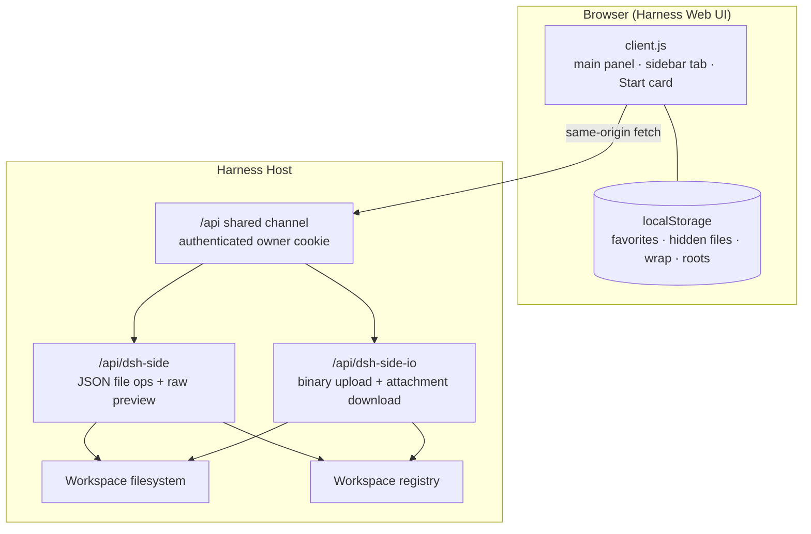

<p align="center">
  
</p>

<h1 align="center">DSH Side</h1>

<p align="center">
  A VS Code-style workspace for the <strong>DeepSeek Harness</strong> Web UI:
  browse, edit, preview, favorite, upload and download workspace files without
  leaving the chat.
</p>

<p align="center">
  <a href="#installation"><strong>Install</strong></a> ·
  <a href="#features">Features</a> ·
  <a href="#usage">Usage</a> ·
  <a href="#how-it-works">How it works</a> ·
  <a href="#development">Development</a> ·
  <a href="README.zh.md">中文文档</a>
</p>

<p align="center">
  
  
  
</p>

---

DSH Side turns the Harness Web UI into a practical coding workspace. It adds a
file explorer and a tabbed editor to the left sidebar and to the right sidebar's
Start page, while keeping the chat and the sessions exactly where they are.

It is a **local bundle**, not an npm package: install it from a cloned checkout
through the Harness Plugin Manager, or ask the Harness agent to install the two
local bundle directories for you.

## Contents

- [Highlights](#highlights)
- [Features](#features)
- [Installation](#installation)
- [Usage](#usage)
- [How it works](#how-it-works)
- [Security and privacy](#security-and-privacy)
- [Compatibility and limitations](#compatibility-and-limitations)
- [Repository layout](#repository-layout)
- [Development](#development)
- [Contributing](#contributing)
- [License](#license)

## Highlights

- **A real editor inside the chat UI** — tabs, syntax highlighting, line numbers,
  word-wrap toggle, save and one-click copy-all.
- **Files, not just previews** — create, rename, delete, upload and download;
  save with stale-file protection.
- **Markdown and PDF previews** — Markdown renders in the panel; PDF and images
  render inline, with a browser handoff.
- **Favorites and a workspace switcher** — single-click a favorite to open a file
  or jump to a folder; clean up workspace entries from the picker.
- **Fits the host** — theme-token styling, English/Chinese copy, compact
  single-column layout in narrow sidebars, and a right-sidebar Start card.

## Features

### Explorer and workspace management

- Browse every registered Harness workspace; switch from the header picker.
- Create files/folders, rename inline (F2), delete with confirmation, refresh.
- Single-click a file to open it; single-click a folder to select it, double-click
  a folder (or its chevron) to expand/collapse.
- One-click **collapse all** under the labeled **More** menu, together with
  **show/hide hidden files**, **go to workspace root**, and refresh.
- **Favorites** per workspace: right-click an entry or use the star in the
  Favorites header; single-click a favorite to open/jump. Favorites follow renames
  and deletions and are persisted in `localStorage`.
- **Workspace picker**: switch roots, see each workspace's full path, and remove a
  single record with the row's trash button. Registered workspaces are removed
  from the Harness Workspace registry (files and sessions are preserved); a
  directory that is only the deployment default is hidden locally.
- **Path address bar**: type a relative path (`src/lib`, `./README.md`) to reveal
  and open it; type an absolute directory outside the current root to register or
  resolve it as a workspace and switch to it. Absolute paths inside the current
  root are located in the tree. `Enter` goes, `Escape` clears.
- **Go to workspace root** from the Home button or `Alt+Home` inside the panel.

### Editor

- Multi-tab editing with dirty indicators, close confirmation, unsaved buffers
  retained while switching panels.
- Save with `⌘/Ctrl+S` or the Save button; reload; stale-file detection with
  Reload/Overwrite choices.
- Syntax highlighting for JavaScript/TypeScript, JSON, CSS, HTML/XML, Python,
  Shell, YAML, SQL, Markdown, Rust, Go, Java, C#, C/C++, Ruby, PHP, Lua, config files,
  and diffs.
- Line numbers, `Tab` indentation, basic auto-indent, and a draggable explorer
  width.
- Word-wrap toggle (remembered, labeled) and **copy all** of the active buffer.
- Markdown preview with headings, lists, tables, fenced code, links and relative
  images; one click to switch between preview and edit.

### Previews and transfer

- PDF preview in an embedded viewer with an "open in browser" action.
- Inline image preview for PNG/JPEG/GIF/WebP/AVIF/BMP/ICO/SVG.
- Binary files offer a browser handoff.
- Upload multiple files from the machine into the selected directory (Explorer
  toolbar or right-click "Upload files here"). Same-name uploads are auto-renamed
  to `name (1).ext`, `name (2).ext`, ...; a single uploaded file opens
  automatically, while multiple files are selected in the tree. Limit:
  **128 MiB per file**.
- Download any open file (editor toolbar or right-click "Download file"). The
  companion route sends `Content-Disposition: attachment`, so PDFs and images are
  saved instead of previewed.

### Integration

- **Left sidebar** panel icon opens the full workspace in the centre column.
- **Right sidebar Start page** gets a third "Code Workspace" card next to
  "Workspace files" and "New terminal"; picking it opens the same workspace as a
  right-sidebar tab.
- Narrow sidebars switch to a compact single-column layout: the explorer first,
  then the editor with a back button in the breadcrumb.
- English and Chinese UI; the client uses only Harness theme tokens (`--dsw-*`) and
  imports no Harness Client package.
- No model-facing tools, prompts, or session events are registered.

## Installation

### Requirements

- A DeepSeek Harness installation with the **Web** profile and the **Plugin
  Manager** page (shipped with the standard Web app).
- Tested with DeepSeek Harness **`0.2.1-rc.2`** on **Linux**. Later releases may
  work, but the slot/service APIs are not guaranteed to be stable between
  releases; macOS/Windows hosts are not explicitly verified.
- No build step, no extra Node dependencies. The bundles are plain ESM and run
  inside the Harness host.
- A current evergreen browser (the UI uses `color-mix`, `ResizeObserver`, and the
  Clipboard API).

The repository contains **two bundles**:

| Directory | Purpose |
| --- | --- |
| `dsh-side-plugin/` | Main plugin: Host file API + browser explorer/editor UI. |
| `dsh-side-io/` | Host-only companion: binary upload and forced-download routes. Required for upload/download; the rest works without it. |

### Install from a local checkout

1. Clone the repository (or download and extract a release):

   ```bash
   git clone <repository-url> dsh-side
   cd dsh-side
   ```

2. In the Harness Web UI, open **Plugins** in the left sidebar.

3. Choose **Add plugin** → **Install a third-party plugin**, and enter the
   **absolute** path to the main bundle:

   ```text
   /absolute/path/to/dsh-side/dsh-side-plugin
   ```

   Confirm the trust prompt, install, then **Enable now** (or switch the bundle on
   from the Installed plugins list).

4. Repeat for the companion bundle:

   ```text
   /absolute/path/to/dsh-side/dsh-side-io
   ```

5. Refresh the Web page if the new entries are not visible yet. The Plugin
   Manager reports when a Harness restart is required; a freshly installed
   bundle normally activates without one.

> **Why two installs?** The main bundle owns the explorer/editor; the companion
> keeps binary host I/O independent. Keep both bundles enabled. If you skip the
> companion, everything except upload and forced download still works.

### Install through the Harness agent

If you are working with the DSH agent, ask it to install the two local bundle
directories:

```text
Install the local DSH bundles at /absolute/path/to/dsh-side/dsh-side-plugin
and /absolute/path/to/dsh-side/dsh-side-io, then enable them.
```

The agent uses the same Plugin Manager installation path as the UI.

### Update and uninstall

- **Update**: in **Plugins → Installed plugins**, uninstall and reinstall each
  bundle from the updated local path (or use the UI's update action when it is
  offered).
- **Uninstall**: uninstall both bundles from **Installed plugins**. This removes
  the profile dependency/link and the plugin rows; it does not delete your cloned
  source or workspace files.
- **Browser state**: preferences and favorites live in the browser's
  `localStorage`. Uninstalling the plugin does not clear them; use your browser's
  site-data controls if you want a clean slate.

### Troubleshooting

| Symptom | What to try |
| --- | --- |
| No new sidebar icon / Start card | Refresh the page. Confirm the main bundle is enabled in **Plugins**. |
| Upload or download fails | Confirm `@local/dsh-side-io` (the companion bundle) is installed and enabled. |
| "只能访问已注册的工作区目录" / "outside-root" | Open the directory once through the address bar so it is registered as a workspace, then retry. |
| Install rejected | Use an **absolute** local path, and check that the directory contains `package.json` and `cordis.patch.yml`. |
| A change is not live | Client-side changes use the browser HMR path; Host-side changes require a Harness restart, as reported by the Plugin Manager. |

## Usage

### Open the workspace

1. Click the new workspace icon in the left sidebar, **or** open the right
   sidebar's Start page and pick **Code Workspace**.
2. Pick a workspace in the header, or type a path in the address bar.

### Keyboard shortcuts

| Shortcut | Action |
| --- | --- |
| `⌘/Ctrl + S` | Save the active file |
| `F2` | Rename the selected file/folder |
| `Delete` | Delete the selected file/folder |
| `Enter` | Open the selected file / toggle the selected folder |
| `←` / `→` | Collapse/expand the focused folder |
| `Alt + Home` | Jump to the current workspace root |
| `Escape` | Close a menu/modal or clear the address input |

### Address bar examples

| Input | Result |
| --- | --- |
| `src/lib` | Expand and select `src/lib` in the tree |
| `./README.md` | Open `README.md` in the editor |
| `/data/projects/app` | Register/resolve the directory as a workspace and open it |
| `/data/projects/app/src` (inside the current root) | Locate `src` in the current tree instead of resetting the workspace |

### Workspaces, hidden files and favorites

- **Hidden files**: dotfiles are hidden by default. Use **More → Show hidden
  files** to toggle; the choice is remembered. Creating or navigating to a dot
  path enables it automatically.
- **Favorites**: right-click a file/folder or use the star in the Favorites
  header. Single-click a favorite to open the file or jump to the folder.
- **Remove a workspace record**: open the workspace picker, hover a row, and click
  the trash button. Removing a registered workspace removes its registration from
  the Harness workspace list; it does **not** delete files, and sessions remain
  (they are simply no longer grouped under that workspace).
- **Go to root**: the Home button in the header, the More menu item, or
  `Alt+Home`.

## How it works



- The browser half registers `main` key `files`, a `sidebar.panellist` entry and
  a `ctx.sidebarRightTabs` type (`kind: dsh-side`) with body/title seats.
- The Host half registers exact `/api` routes through
  `ctx.connection.fetch.register`. Only owner peers reach an exact route, so the
  browser's signed session cookie is the authentication input; the plugin does
  not mint a token.
- Every path is resolved and checked inside the selected root; symlinks are
  resolved before the containment check. The root itself cannot be renamed or
  deleted through the plugin. File mutations use Node's filesystem APIs because
  the shipped `workspaceFiles` Remote namespace is read-only.
- Uploads are written with `wx` and auto-renamed on collision. Downloads are
  streamed with `Content-Disposition: attachment`.

## Security and privacy

DSH Side is a **local-first** plugin with filesystem access. Review the source
before enabling it, and only install bundles you trust. To report a
vulnerability, follow [`SECURITY.md`](SECURITY.md) — please do not open a public
issue for security-sensitive reports.

- **Authentication**: the `/api` exact routes are reachable only by the owner
  browser with a valid Harness session cookie; no extra token or unauthenticated
  port is introduced.
- **Confinement**: all reads and writes are confined to a registered workspace
  root (or the deployment default directory). Paths are split into segments,
  `..` is rejected, and symlinks are resolved before containment is checked.
- **No telemetry**: the plugin makes no analytics or external network requests.
- **No model-visible data**: it registers no tools, prompts, system-prompt
  sections, or session events. Opening a file in the editor does not add it to the
  conversation.
- **Limits**: editor text reads 8 MiB; raw previews 128 MiB; uploads 128 MiB per
  file.
- **Filesystem permissions**: the plugin runs with the Harness host's filesystem
  permissions. Removing a workspace registration does not delete any file.

## Compatibility and limitations

- **No build and no npm publication**: the packages use the `@local/` scope and are
  intended to be installed as local bundles. Rename the packages if you want to
  publish your own fork to a registry.
- **No folder upload/download**: only individual files are transferred. Upload a
  folder by creating it in the UI and uploading its files, or zip it externally.
- **No automatic file watching**: external changes appear after a manual refresh
  or reload; saves use stale-file protection.
- **No Git UI, search, or drag-and-drop** yet.
- **One active root per view**: multiple workspaces are available through the
  picker, but the tree shows the selected root.
- **No binary editing**: binary files are previewed (images/PDF) or handed to the
  browser.
- **Host API stability**: built against the `0.2.1-rc.2` Harness package APIs. A
  future Harness release may require updates to the slot/service contracts.

## Repository layout

```text
dsh-side/
├── dsh-side-plugin/          # main bundle: Host API + browser UI
│   ├── index.js              # /api/dsh-side Host route
│   ├── client.js             # main panel, sidebar card, explorer/editor UI
│   ├── cordis.patch.yml      # inserts the host plugin row
│   ├── locale/{en,zh}.json   # plugin display metadata
│   └── icon.svg
├── dsh-side-io/              # host-only companion bundle
│   ├── index.js              # /api/dsh-side-io upload/download route
│   ├── cordis.patch.yml
│   ├── locale/{en,zh}.json
│   └── icon.svg
├── README.md
├── README.zh.md
├── LICENSE
├── CHANGELOG.md
├── .gitignore
├── SECURITY.md
├── scripts/check-json.mjs
└── package.json              # private workspace + syntax-check scripts
```

## Development

The plugin is intentionally **plain JavaScript with no build step**.

```bash
# Syntax checks for the three runtime modules
npm run check

# Validate package/locale JSON
npm run check:json
```

- **Client half**: `client.js` registers a lazy factory via
  `window.__ModuleLoader__.load`; React comes from the browser module table, and
  the UI styles itself with Harness theme tokens.
- **Host half**: `index.js` exports `apply`/`inject` and registers an exact route
  on `ctx.connection.fetch`.
- **Install for development**: install each local package directory through the
  Plugin Manager (or ask the agent). The client bundle is picked up by the HMR
  watch; Host changes require a Harness restart. If the local install copies rather
  than links the package, reinstall after edits.
- **Data keys** stored by the client:

  | Key | Contents |
  | --- | --- |
  | `dsh-side:root` | Last opened workspace path |
  | `dsh-side:tree-width` | Explorer width in px |
  | `dsh-side:show-hidden` | Show dotfiles (`1`/`0`) |
  | `dsh-side:favorites` | Per-root favorites map |
  | `dsh-side:favorites-open` | Favorites section open state |
  | `dsh-side:word-wrap` | Word-wrap toggle |
  | `dsh-side:hidden-roots` | Locally hidden directory paths |

- **Localization**: runtime strings live in `client.js` (`zh`/`en` dicts); the
  plugin-manager display metadata lives in `locale/*.json`.

## Contributing

Issues and pull requests are welcome. Please keep the plugin dependency-free and
plain-ESM, run `npm run check` before opening a PR, and describe any new Host route
or slot registration in the PR. For UI changes, include a screenshot or a short
recording if you can.

## License

[MIT](LICENSE) © DSH Side contributors.
