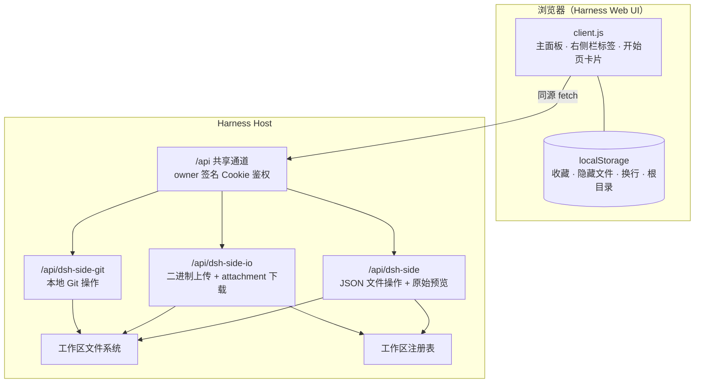

<p align="center">
  
</p>

<h1 align="center">Deepseek Harness Web 增强文件管理器</h1>

<p align="center">
  为 <strong>DeepSeek Harness</strong> Web UI 提供 VS Code 风格工作区：
  不离开对话即可浏览、编辑、预览、收藏、上传和下载工作区文件，并完成本地 Git 提交。
</p>

<p align="center">
  <a href="#安装"><strong>安装</strong></a> ·
  <a href="#功能">功能</a> ·
  <a href="#使用">使用</a> ·
  <a href="#工作原理">工作原理</a> ·
  <a href="#开发">开发</a> ·
  <a href="README.md">English</a>
</p>

---

DSH Side 把 Harness Web UI 变成一个真正可用的编码工作区：它在左侧栏和右侧栏
「开始」页中加入文件树与多标签编辑器，同时保持原有的对话和会话界面不变。

这是一组**本地 bundle**（不是 npm 包）：从克隆下来的仓库目录，通过 Harness 的
插件管理器安装；也可以直接让 Harness agent 帮你安装这三个本地目录。

## 目录

- [功能](#功能)
- [安装](#安装)
- [使用](#使用)
- [工作原理](#工作原理)
- [安全与隐私](#安全与隐私)
- [兼容性与限制](#兼容性与限制)
- [目录结构](#目录结构)
- [开发](#开发)
- [参与贡献](#参与贡献)
- [许可证](#许可证)

## 功能

### 目录与工作区

- 浏览所有已注册的 Harness 工作区，可在顶部切换。
- 新建文件/文件夹、内联重命名（F2）、删除（带确认）、刷新。
- 单击文件打开；单击目录选中；双击目录（或点箭头）展开/收起。
- 「更多」菜单中提供：**全部收起**、**显示/隐藏隐藏文件**、**回到工作区根目录**、刷新。
- **收藏夹**（按工作区分开保存）：右键文件/目录，或点收藏夹标题栏星标收藏；
  单击收藏项即可打开文件或跳转到目录；重命名/删除会自动同步。
- **工作区选择器**：显示标题与完整路径，每行右侧垃圾桶可移除单条记录。
  已注册工作区会从 Harness 工作区注册表移除（不删磁盘文件，会话保留）；仅作为
  内置默认目录的路径会在本地隐藏。
- **路径地址栏**：输入相对路径（`src/lib`、`./README.md`）直接定位/打开；
  输入当前根目录之外的绝对目录会注册/解析为工作区并切换过去；当前根目录内的
  绝对路径只在树内定位。`Enter` 直达，`Esc` 清空。
- **回到工作区根目录**：顶部 Home 按钮，或面板内 `Alt+Home`。

### 编辑器

- 多标签编辑，未保存圆点、关闭确认；切换面板时保留未保存内容。
- 保存（`⌘/Ctrl+S` 或按钮）、重新加载、磁盘变更冲突保护（可重新加载或强制覆盖）。
- 语法高亮：JS/TS、JSON、CSS、HTML/XML、Python、Shell、YAML、SQL、Markdown、
  Rust、Go、Java、Kotlin、Scala、Swift、Dart、Groovy、C#、C/C++、Objective-C、
  Ruby、PHP、Lua、R、Perl、PowerShell、F#、VB.NET、Razor、Protocol Buffers、
  GraphQL、Terraform、CMake、Dockerfile、Makefile、配置文件、diff。
- 行号、Tab 缩进、基础自动缩进、可拖拽的目录树宽度。
- 自动换行开关（记忆状态、带文字标签），以及**一键复制全文**。
- Markdown 预览（标题、列表、表格、代码块、链接、相对图片），可一键切换编辑/预览。

### 预览与传输

- PDF 内嵌预览，并可跳转浏览器打开。
- 图片内联预览（PNG/JPEG/GIF/WebP/AVIF/BMP/ICO/SVG）。
- 其他二进制文件提供浏览器打开入口。
- **上传**：资源管理器工具栏或右键「上传文件到此处」，支持多文件；同名自动重命名为
  `name (1).ext`、`name (2).ext`…；只上传一个文件时自动打开。单文件上限 **128 MiB**。
- **下载**：编辑器工具栏或右键「下载文件」；响应强制
  `Content-Disposition: attachment`，PDF/图片直接保存。

### 集成

- **左侧栏**图标：在中央面板打开完整工作区。
- **右侧栏「开始」页**：新增第三张「代码工作区」卡片，点击后以右侧栏标签页打开；
  窄侧栏自动切换为「目录 / 编辑器」单列布局，面包屑提供返回按钮。
- 中英文 UI；仅使用 Harness 主题 token（`--dsw-*`），不引入任何 Harness Client 包。
- 不注册任何模型可见的工具、提示词或会话事件。

### Git 源代码管理

- 资源管理器标题栏新增 **Git** 按钮，可在文件树与 Git 视图之间切换。
- 显示当前分支、上游、领先/落后数量、未提交/分离状态、已暂存更改、工作区更改和未跟踪文件。
- 支持单文件/全部暂存与取消暂存、填写提交信息并提交（`Ctrl/⌘+Enter`）、以只读弹窗查看变更或未跟踪文本文件的 diff。
- 不是仓库时可初始化；支持列出本地分支并切换。
- Git 只在本地 Host 执行：不提供 fetch/pull/push，不保存远程凭证，也不支持按 hunk 暂存。
- Git 视图要求工作区就是仓库**根目录**；打开子目录时会提示，而不是在根目录之外暂存。

### 截图预览
  
  
  
  
  

## 安装

### 前置条件

- 带 **Web** profile 和 **插件管理器** 页面的 DeepSeek Harness。
- 已在 **Linux** 上测试：DeepSeek Harness **`0.2.1-rc.2`**。更高版本可能可用，但
  Harness 的 slot/service API 不保证稳定；macOS/Windows 宿主未做显式验证。
- 无需构建、无额外 Node 依赖；三个 bundle 都是普通 ESM，直接在 Harness Host 中运行。
- 较新的现代浏览器（使用了 `color-mix`、`ResizeObserver`、Clipboard API）。
- Git 功能需要 Host 的 `PATH` 中有 `git`，并配置提交身份（`user.name` / `user.email`）。

仓库包含**三个 bundle**：

| 目录 | 作用 |
| --- | --- |
| `dsh-side-plugin/` | 主插件：Host 文件 API + 浏览器目录/编辑器 UI。 |
| `dsh-side-io/` | 仅 Host 的配套插件：二进制上传与强制下载路由。上传/下载依赖它，其余功能可单独使用。 |
| `dsh-side-git/` | 仅 Host 的配套插件：本地 Git 状态、暂存、提交、diff 和分支操作。Git 视图依赖它。 |

### 从本地目录安装

1. 克隆仓库（或下载 Release 解压）：

   ```bash
   git clone <repository-url> dsh-side
   cd dsh-side
   ```

2. 打开 Harness Web UI → 左侧 **插件 / Plugins**。

3. 点 **添加插件（Add plugin）** → **安装第三方插件（Install a third-party plugin）**，
   填入主 bundle 的**绝对路径**：

   ```text
   /absolute/path/to/dsh-side/dsh-side-plugin
   ```

   确认信任提示并安装，完成后点 **立即启用（Enable now）**（或在已安装插件列表中打开）。

4. 对二进制配套插件重复一次：

   ```text
   /absolute/path/to/dsh-side/dsh-side-io
   ```

5. 对 Git 配套插件重复一次：

   ```text
   /absolute/path/to/dsh-side/dsh-side-git
   ```

6. 如果页面还没出现新入口，刷新一次 Web 页面。插件管理器会提示是否需要重启
   Harness；通常新安装的 bundle 不需要重启即可生效。

> **为什么装三个？** 主 bundle 负责目录/编辑器，IO 配套插件负责二进制上传/下载，
> Git 配套插件负责本地 Git 操作。三个都请保持启用；不装 IO 时上传/强制下载不可用，
> 不装 Git 时 Git 视图会提示安装。

### 通过 Harness agent 安装

如果你正在使用 DSH agent，可以直接说：

```text
请安装这三个本地 DSH bundle：
/absolute/path/to/dsh-side/dsh-side-plugin
/absolute/path/to/dsh-side/dsh-side-io
/absolute/path/to/dsh-side/dsh-side-git
并启用它们。
```

Agent 会走与插件管理器相同的安装流程。

### 更新与卸载

- **更新**：在 **插件 → 已安装插件** 中卸载后，从新的本地路径重新安装；如果页面
  提供 Update 操作也可直接使用。
- **卸载**：卸载三个 bundle。会移除 profile 的依赖/链接与插件行，不会删除你克隆的源码或工作区文件。
- **浏览器数据**：偏好与收藏保存在浏览器 `localStorage`，卸载插件不会自动清除；
  如需彻底清理，可在浏览器站点数据中删除。

### 常见问题

| 现象 | 处理 |
| --- | --- |
| 没有新的侧栏图标 / 开始页卡片 | 刷新页面；确认主 bundle 已启用。 |
| 上传或下载失败 | 确认 IO 配套插件 `@local/dsh-side-io` 已安装并启用。 |
| Git 视图提示未安装 | 安装并启用 `@local/dsh-side-git`。 |
| Git 视图提示不是仓库根目录 | 直接打开仓库根目录作为工作区；Git 操作只允许在该根目录内。 |
| 提交提示身份未知 | 在 Harness Host 上配置 `user.name` / `user.email`。 |
| 提示只能访问已注册工作区 / outside-root | 先用地址栏打开一次该目录，使其注册为工作区。 |
| 安装被拒绝 | 使用**绝对路径**，确认目录中有 `package.json` 和 `cordis.patch.yml`。 |
| 修改没有生效 | 客户端走 HMR；Host 侧修改需要按插件管理器提示重启 Harness。 |

## 使用

### 打开工作区

1. 点击左侧栏新增的工作区图标，**或**打开右侧栏「开始」页选择「代码工作区」。
2. 在顶部选择工作区，或在地址栏输入路径。

### 快捷键

| 快捷键 | 操作 |
| --- | --- |
| `⌘/Ctrl + S` | 保存当前文件 |
| `F2` | 重命名选中项 |
| `Delete` | 删除选中项 |
| `Enter` | 打开选中文件 / 展开收起选中目录 |
| `← / →` | 收起 / 展开当前聚焦的目录 |
| `Alt + Home` | 回到当前工作区根目录 |
| `Ctrl/⌘ + Enter` | 在 Git 提交信息框中提交已暂存更改 |
| `Esc` | 关闭菜单/弹窗，或清空地址栏 |

### 地址栏示例

| 输入 | 结果 |
| --- | --- |
| `src/lib` | 在树中展开并选中 `src/lib` |
| `./README.md` | 在编辑器中打开 `README.md` |
| `/data/projects/app` | 注册/解析为工作区并打开 |
| `/data/projects/app/src`（在当前根目录内） | 只在当前树中定位 `src`，不切换工作区 |

### 工作区、隐藏文件与收藏

- **隐藏文件**：默认隐藏 dotfile；在 **更多 → 显示隐藏文件** 切换，状态会记忆。
  新建或跳转到 dot 路径时自动打开显示。
- **收藏**：右键文件/目录或使用收藏夹标题栏星标；单击收藏项打开文件或跳转目录。
- **移除工作区记录**：打开工作区选择器，悬停某行，点行尾垃圾桶。注册工作区会从
  Harness 工作区列表移除；不会删除磁盘文件，会话保留但不再归入该工作区。
- **回到根目录**：顶部 Home 按钮、「更多」菜单项，或 `Alt+Home`。

### Git 工作流

1. 点击资源管理器标题栏的 **Git**（分支）按钮，文件树会切换为源代码管理视图；再点一次返回。
2. 如果工作区不是仓库，点「初始化仓库」。如果它只是大仓库的子目录，请改为打开仓库根目录。
3. 在更改文件上点 **+** 暂存，或点「全部暂存」；在已暂存区域用 **−** / 「全部取消暂存」撤销。
4. 填写提交信息并点「提交」（或按 `Ctrl/⌘+Enter`）；成功后列表会自动刷新。
5. 点击文件行查看只读统一 diff；可在弹窗中直接打开文件。
6. 点击分支按钮列出本地分支并切换。

Git 仅本地执行：不提供 fetch/pull/push，不保存凭证。提交会运行仓库配置的 hooks，
请只在信任其 hooks 的仓库中提交。

## 工作原理



- 浏览器半注册 `main` 的 `files` 键、`sidebar.panellist` 入口，以及
  `ctx.sidebarRightTabs` 类型（`kind: dsh-side`）及其 body/title 座位。
- Host 半通过 `ctx.connection.fetch.register` 注册 `/api` 精确路由。只有 owner
  peer 能进入精确路由，浏览器签名 Cookie 即鉴权输入，插件不额外生成 token。
- 所有路径都在选定根目录内解析和校验；符号链接在包含检查之前先解析；
  根目录本身不能被插件重命名或删除。文件写入使用 Node 文件系统 API，因为内置的
  `workspaceFiles` Remote 命名空间是只读的。
- 上传使用 `wx` 打开避免静默覆盖，同名自动重命名；下载以
  `Content-Disposition: attachment` 流式返回。
- Git 配套插件通过 `execFile('git', args)` 调用（不经过 shell），要求工作区为仓库根目录，
  路径校验后放在 `--` 之后；不执行任何网络命令。

## 安全与隐私

DSH Side 是**本地优先**插件，拥有文件系统访问能力。启用前请阅读源码，只安装可信来源。
安全问题请按 [`SECURITY.md`](SECURITY.md) 私下报告，不要开公开 Issue。

- **鉴权**：`/api` 精确路由只有携带有效 Harness 会话 Cookie 的 owner 浏览器可达，
  不引入额外 token 或未鉴权端口。
- **范围限制**：所有读写限定在已注册工作区根目录（或部署默认目录）内；拒绝 `..`，
  解析符号链接后再做包含检查。
- **无遥测**：不包含分析、追踪代码，也没有硬编码的外部接口。Markdown 文件中的外部链接/图片
  只在你预览该文件时由浏览器加载；图片使用 `referrerPolicy="no-referrer"`，不会把 Harness
  页面地址作为 Referer 发送给第三方主机。
- **模型不可见**：不注册工具、提示词、系统提示或会话事件；在编辑器中打开文件不会
  写入对话。
- **Git 仅本地**：不提供 fetch/pull/push，不保存远程凭证。Git 在选中的仓库内执行，
  仓库本地配置、hooks 或 fsmonitor 可能执行代码；请只在信任的仓库中使用 Git。
- **限制**：编辑器文本读取 8 MiB；原始预览 128 MiB；单文件上传 128 MiB。
- **权限**：插件使用 Harness Host 的文件系统权限；移除工作区注册不会删除任何文件。

## 兼容性与限制

- **无构建、未发布 npm**：包使用 `@local/` 作用域，设计为本地 bundle；如需发布自己的
  fork 到 registry，可自行重命名包。
- **不支持整目录上传/下载**：只传输单个文件；可先在 UI 中建目录再上传其中文件，或在
  外部打包。
- **无文件自动监听**：外部修改需手动刷新或重新加载；保存有 stale 冲突保护。
- **暂无 pull/push、merge/rebase、按 hunk 暂存、搜索、拖拽上传**。
- **Git 要求工作区就是仓库根目录**；仓库顶层在父目录时不支持变更操作。
- **单视图单根目录**：通过选择器切换多个工作区，但树只显示当前根目录。
- **不支持二进制编辑**：图片/PDF 预览，其他二进制交给浏览器。
- **Host API 稳定性**：基于 `0.2.1-rc.2` 的 Harness 包 API 构建；未来版本可能需要适配
  slot/service 契约。

## 目录结构

```text
dsh-side/
├── dsh-side-plugin/          # 主 bundle：Host API + 浏览器 UI
│   ├── index.js              # /api/dsh-side Host 路由
│   ├── client.js             # 主面板、侧栏入口、目录/编辑器 UI
│   ├── cordis.patch.yml      # 插入 Host 插件行
│   ├── locale/{en,zh}.json   # 插件管理器显示元数据
│   └── icon.svg
├── dsh-side-io/              # 仅 Host 的二进制配套插件
│   ├── index.js              # /api/dsh-side-io 上传/下载路由
│   ├── cordis.patch.yml
│   ├── locale/{en,zh}.json
│   └── icon.svg
├── dsh-side-git/             # 仅 Host 的 Git 配套插件
│   ├── index.js              # /api/dsh-side-git status/stage/commit/diff/branch
│   ├── cordis.patch.yml
│   ├── locale/{en,zh}.json
│   └── icon.svg
├── README.md
├── README.zh.md
├── LICENSE
├── CHANGELOG.md
├── .gitignore
├── SECURITY.md
├── scripts/check-json.mjs
└── package.json              # private workspace + 语法检查脚本
```

## 开发

插件刻意保持**纯 JavaScript、无构建步骤**。

```bash
# 四个运行时模块的语法检查
npm run check

# 校验 package/locale JSON
npm run check:json
```

- **客户端**：`client.js` 通过 `window.__ModuleLoader__.load` 注册懒加载工厂；
  React 来自浏览器模块表，样式只使用 Harness 主题 token。
- **Host 侧**：每个 host bundle 的 `index.js` 导出 `apply`/`inject`，在 `ctx.connection.fetch` 上注册精确路由。
- **开发安装**：通过插件管理器安装三个本地目录（或让 agent 安装）。客户端由 HMR 监听；
  Host 侧改动需要重启 Harness。若本地安装是拷贝而非链接，修改后需重新安装。
- **客户端本地键**：

  | Key | 内容 |
  | --- | --- |
  | `dsh-side:root` | 上次打开的工作区路径 |
  | `dsh-side:tree-width` | 目录树宽度（px） |
  | `dsh-side:show-hidden` | 是否显示 dotfile（`1`/`0`） |
  | `dsh-side:favorites` | 按根目录保存的收藏 |
  | `dsh-side:favorites-open` | 收藏夹展开状态 |
  | `dsh-side:word-wrap` | 自动换行状态 |
  | `dsh-side:hidden-roots` | 本地隐藏的目录路径 |

- **本地化**：运行时文案在 `client.js` 的 `zh`/`en` 字典；插件管理器显示元数据在
  `locale/*.json`。

## 参与贡献

欢迎提 Issue 和 PR。请保持插件无第三方依赖、纯 ESM，提交前运行 `npm run check`；
新增 Host 路由或 slot 注册时请在 PR 中说明。UI 改动请尽量附截图或录屏。

## 许可证

[MIT](LICENSE) © DSH Side contributors.
