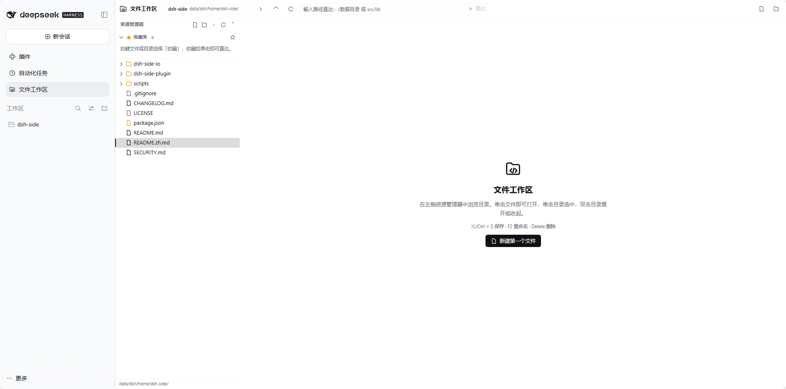
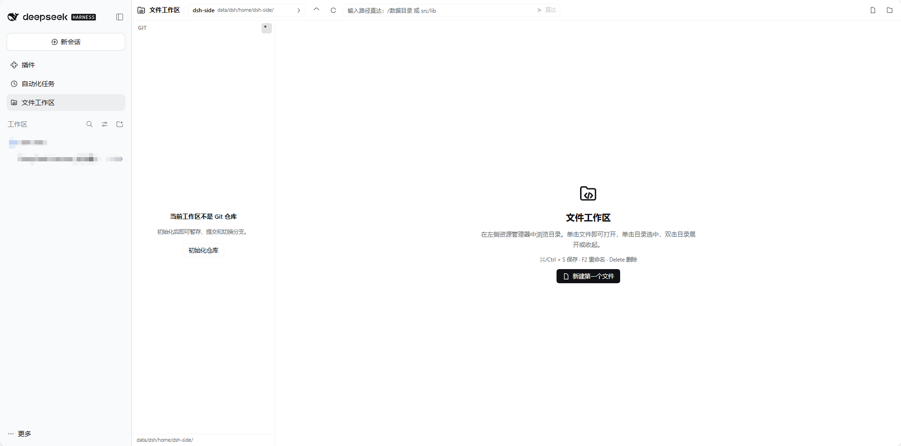
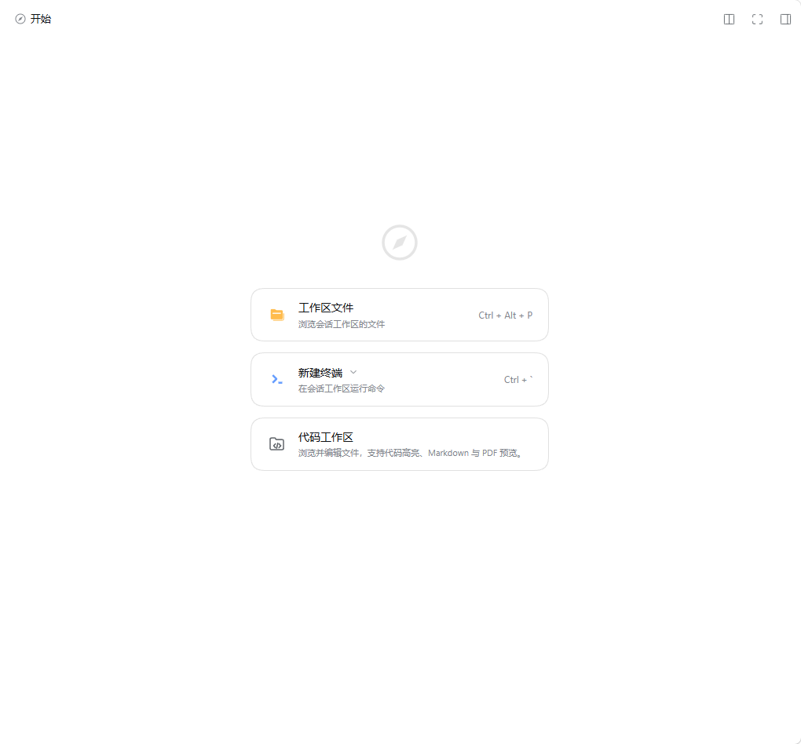
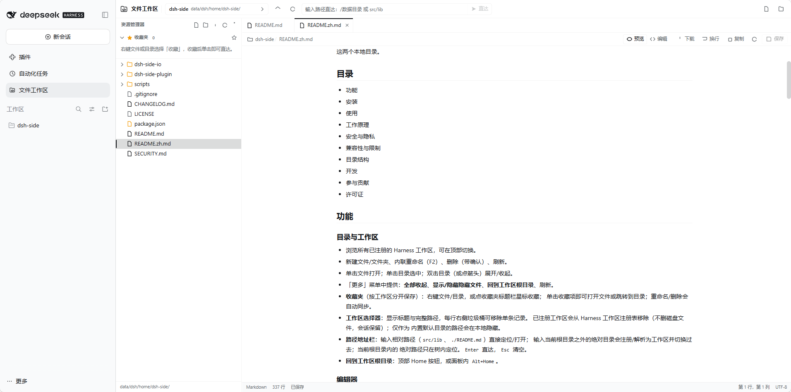
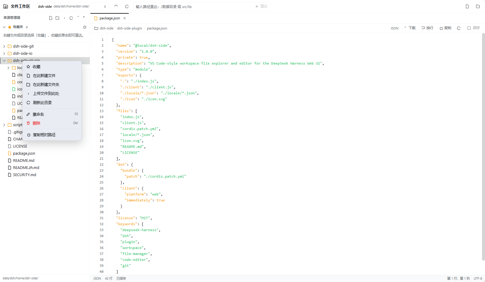
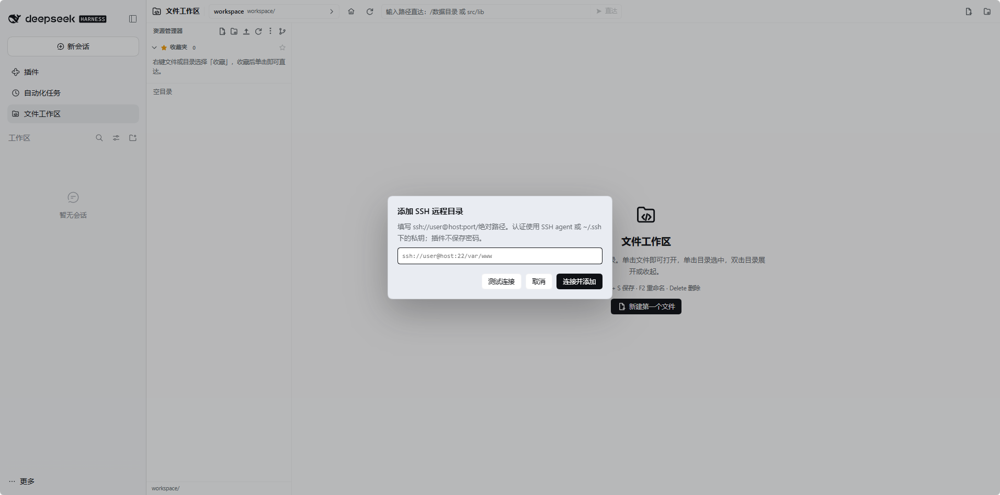
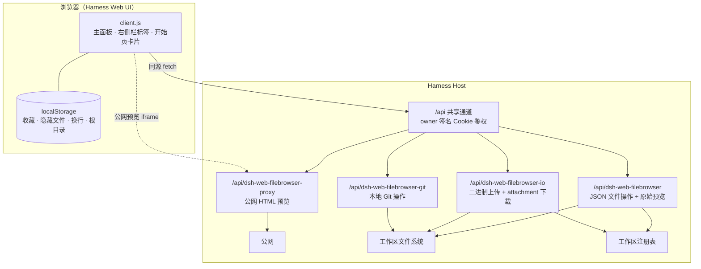

# DeepSeek Harness Web 开发工作区

为 **DeepSeek Harness** Web UI 提供 VS Code 风格开发工作区：
浏览、编辑和搜索工作区文件，完成 Git、终端与浏览器任务，
悬浮对话、Agent 协作和工作区记忆始终在同一个界面，无需离开对话。

**[安装](#安装)** · [速览](#功能速览) · [功能](#功能) · [使用](#使用) · [工作原理](#工作原理) · [开发](#开发) · [English](README.md)

---

开发工作区把 Harness Web UI 变成一个真正可用的编码工作区：它在左侧栏和右侧栏
「开始」页中加入工作区入口，同时保持原有的对话和会话界面不变。

这是一个**本地组合 bundle**（不是 npm 包）：从克隆下来的仓库根目录，通过 Harness
的插件管理器安装一次；也可以直接让 Harness agent 帮你安装。

## 功能速览

- **聊天界面里的编辑器**：多标签、语法高亮、行号、自动换行、查找替换、保存和一键复制全文。
- **真正的文件管理**：新建、重命名、移动、复制、删除、上传和下载；支持从系统拖入文件，保存带磁盘冲突保护。
- **搜索与快速打开**：工作区全文搜索、`Ctrl/⌘ + P` 文件筛选和 `Ctrl/⌘ + Shift + P` 命令面板。
- **Markdown、PDF 与图片预览**：Markdown 实时分屏预览，PDF/图片内联显示，二进制文件交给浏览器。
- **本地 Git 工作流**：查看更改与提交图，暂存、提交、还原、储藏、切换分支、diff、比较及 fetch/pull/push；底部 Git 标签用琥珀色数量提示未提交修改。
- **内置终端**：基于 xterm.js，可在底部面板与编辑区之间移动；本地工作区可手动检测项目常用命令，
  SSH 工作区则通过 ssh2 在远端打开交互式 shell。
- **内置浏览器**：在代码旁预览本地开发服务器，支持 PC/移动端视口、工作区收藏地址
  （记住 PC/手机视口与协议/主机设置）和公共页面代理。
- **工作区全屏**：让整个工作区占满真实浏览器视口，保留资源树、标签、编辑器/浏览器和终端，
  桌面和移动端都能使用。
- **收藏夹与工作区切换**：单击收藏项打开文件或目录；在工作区选择器中清理旧记录。
- **悬浮对话**：最大化文件工作区时，当前对话仍以可移动、可缩放的面板保持可见。
- **Agent 协作**：把选中代码交给对话解释、修复或写测试；点击操作之前不会发送任何内容。
- **SSH 远程目录**：通过 SFTP 浏览和编辑远程目录，支持 SSH agent、密钥或一次性密码。
- **跨会话工作区记忆**：每个工作区拥有持久笔记，同一工作区的会话共享并自动注入模型。
- **开发待办清单**：按工作区保存任务，支持优先级、截止日期、标签、备注、筛选和排序，模型也能读写。
- **任务与复测**：侧栏「任务」视图自动检测 build / test / lint / dev 命令，一键运行并流式查看输出与退出码；失败输出会解析成可点击的「文件:行」，点一下直接跳到编辑器。刷新页面后仍在运行的任务会被重新接上。
- **文件属性**：资源管理器右键文件/文件夹 → 属性，查看类型、位置、大小（文件夹递归小计与项目数）、修改/创建/访问时间、权限、只读、符号链接目标。
- **需求修订中心**：项目进行中即可「追加说明 / 修改需求」，完成后可「新轮变更」；每次修订有类型与时间记录，并自动派发产品经理吸收到需求文档与验收项。
- **变更轮次与适用范围**：项目交付后可「发起变更」开启第 N 轮，并选择完整六关 / 仅开发调整（跳过需求设计）/ 仅发布调整（只走确认与发布）；跳过的阶段带原因保留，自动从所选范围的第一关开始。
- **运行与检查面板**：任务视图改为结果优先——最近一次运行的命令/状态/耗时置顶，快捷命令 chips 一键运行，运行记录带耗时与退出码，错误可点击跳转、失败可一键发回 agent。
- **欢迎页改版**：空工作区不再是一列按钮——图标、快捷键徽标、主操作 + 2×2 快捷卡片（工作台 / 内置浏览器 / 快速打开 / 终端），一眼看清能做什么。
- **需求一键录入**：工作台支持粘贴需求、拖入截图或需求文档，点「交给产品经理」即自动梳理成可落地方案并启动流水线，中间阶段自动推进，只在最终确认与发布时找人。
- **工作台首页**：工作台以**编辑器标签页**的形式出现在主内容区（可与其他文件标签来回切换），打开工作区默认聚焦它；一屏看完当前项目阶段流程（六关状态/负责人/耗时/流程记录）、需要你处理的审批、验收结论、交付物与运行中任务并直接操作；侧栏只保留 文件 / 搜索 / Git / 更多，项目与开发视图收进分组菜单。
- **OPC 团队**：产品经理 / UI 设计师 / 全栈开发 / 测试 / 运维五个常驻角色 + Lead，按「需求 → 设计 → 开发 → 测试 → 确认 → 发布」六阶段交付，每个角色有边界手册与产物模板；公司宪章与名册见 [docs/opc/](docs/opc/README.md)。
- **交付流水线与智能体团队**：侧栏「流水线」把需求按「产品经理 → UI 设计师 → 全栈开发 → 测试 → 项目经理确认 → 运维发布」六阶段推进；每个阶段派发带角色边界的提示词，agent 用原生 `spawn_teammate` / `team_task_*` 组队执行，阶段提交后由你在面板通过或打回，**批准前发布阶段不可启动**。角色边界与操作流程见 [docs/AGENT_TEAM.md](docs/AGENT_TEAM.md)。
- **验收台与交付**：侧栏「验收」视图维护 `.dsh/acceptance.json` 验收清单（待验收 / 通过 / 不通过 / 阻塞 + 备注），一键导出 Markdown 验收报告、把未通过项发回 agent；Git 更改列表支持逐文件「已审」标记；交付时可下载构建产物 zip，或把验收报告和产物一起打包到 `.dsh/deliveries/`。
- **贴合宿主**：主题变量配色、中英文界面、窄侧栏单列布局、右侧栏开始卡片，以及手机/平板布局。

## 目录

- [功能速览](#功能速览)
- [功能](#功能)
- [安装](#安装)
- [使用](#使用)
- [工作原理](#工作原理)
- [安全与隐私](#安全与隐私)
- [兼容性与限制](#兼容性与限制)
- [目录结构](#目录结构)
- [开发](#开发)
- [参与贡献](#参与贡献)
- [许可证](#许可证)

## 功能

### 目录与工作区

- 浏览所有已注册的 Harness 工作区，可在顶部切换。
- 资源管理器标题栏的 **左右切换按钮** 可以把文件树移到编辑区左侧或右侧，位置会保存；
  分隔条拖拽方向也会随位置自动调整。
- 新建文件/文件夹、内联重命名（F2）、删除（带确认）、刷新。
- 右键支持**复制 / 剪切 / 粘贴**，可在目录间移动或复制文件与目录；也可把树中的条目拖到目录上完成移动；右键菜单还能复制相对路径或绝对路径。
- 可把系统文件直接拖入文件树或目录上传，自动处理重名（单文件上限 128 MiB）。
- 单击文件打开；单击目录选中；双击目录（或点箭头）展开/收起。
- 资源管理器与 VS Code 一致：已展开的目录若只有一个子目录、且该子目录也已展开，
  会合并成 `parent/child/grandchild` 一行显示；展开的空目录不再显示占位行。
- 侧栏标题栏直接提供按钮：**全部收起**、**显示/隐藏隐藏文件**、**回到工作区根目录**、刷新。
- **收藏夹**（按工作区分开保存）：右键文件/目录，或点收藏夹标题栏星标收藏；
  单击收藏项即可打开文件或跳转到目录；重命名/删除会自动同步。
- **工作区选择器**：显示标题与完整路径，每行右侧垃圾桶可移除单条记录。
  已注册工作区会从 Harness 工作区注册表移除（不删磁盘文件，会话保留）；仅作为
  内置默认目录的路径会在本地隐藏。
- **路径地址栏**：输入相对路径（`src/lib`、`./README.md`）直接定位/打开；
  输入当前根目录之外的绝对目录会注册/解析为工作区并切换过去；当前根目录内的
  绝对路径只在树内定位。`Enter` 直达，`Esc` 清空。
- **回到工作区根目录**：顶部 Home 按钮，或面板内 `Alt+Home`。

### 搜索、快速打开与 Harness

- **全局搜索**：侧栏 Search 标签按文件内容搜索当前工作区，支持区分大小写和正则；
  结果按文件分组，点击跳转到对应行。跳过 `node_modules`、`.git`、`dist` 等目录，
  单文件上限 2 MiB，结果数量有上限。SSH 工作区暂不支持全局搜索。
- **快速打开**：`Ctrl/⌘ + P` 模糊筛选文件名；`Ctrl/⌘ + Shift + P` 打开命令面板，
  可执行新建文件、搜索、刷新、打开终端/浏览器/记忆/待办等命令。
- **自动刷新**：本地工作区通过 Host watcher 长轮询感知已展开目录的变化（Host 不支持时退回每 5 秒检查），
  外部新增/删除/重命名会立即更新文件树；打开的文件每 5 秒检查：未修改的标签自动重新加载，
  有未保存更改时提示「重新加载」或「保留我的更改」。
- **文件内查找替换**：编辑器内 `Ctrl/⌘ + F` 打开查找栏，支持上下跳转、区分大小写、
  替换当前和全部替换。
- **Harness 面板**：顶栏右侧的小图标（在浏览器按钮与最大化之间）打开 Harness 信息面板，
  显示当前 profile、插件版本、bundles、依赖和 profile 配置文件；可直接查看
  `cordis.yml`、`cordis.patch.yml`、`package.json`，并运行插件自带的 `npm run check`
  查看输出。面板不占用侧栏视图标签；再点一次顶栏图标或面板标题栏的 × 会回到之前的视图，
  命令面板（`Ctrl/⌘ + Shift + P`）里也可以打开。

### 跨会话工作区记忆

- 每个**本地工作区**在 `.dsh/memory.json` 中保存独立记忆，同一工作区的所有聊天会话共享；
  其他工作区完全看不到。未归入工作区的会话以其记录的工作目录为范围。
- 模型获得 `memory_save`、`memory_search`、`memory_update`、`memory_delete` 四个工具，
  以及一段简短的系统提示。已有记忆会以 `workspace-memory` 运行时上下文自动注入
  （最多 4,000 字符），新会话因此能继承之前会话保存的约定、决策和环境信息。
- 侧栏新增 **记忆** 标签：查看、添加、编辑和删除（显示标签与时间），与模型工具共用
  同一份存储，修改会在下一次请求生效。
- 首次写入时若不存在 `.dsh/.gitignore` 会创建（内容 `*`），默认不进入 Git；
  JSON 文件也可手动查看/编辑。文件损坏时会显式报错，不会静默丢弃。
- 上限：每个工作区 200 条、每条 4,000 字符、每条最多 8 个标签。SSH 远程工作区和缺少
  `tools` / `systemPrompt` 服务的 profile 不启用记忆。

### 开发待办清单

- 每个**本地工作区**在 `.dsh/todos.json` 中保存独立待办，侧栏 **待办** 标签与模型工具
  共用同一份数据，切换工作区时自动切换任务板。
- 快速添加任务：输入标题后按回车；可同时设置优先级（低/普通/高/紧急）、截止日期和标签。
  任务行内支持勾选完成、重新打开、编辑标题与备注、删除，以及一键清理全部已完成任务。
- 面板顶部显示待办/完成数量、完成进度和过期数量；截止日期会标出“逾期 N 天”“今天到期”
  “明天到期”。支持按待办/已完成/全部筛选，按标题、备注和标签搜索，并按优先级、截止日期、
  最近更新或创建时间排序；筛选与排序选择会保存。
- 模型获得 `todo_list`、`todo_add`、`todo_update`、`todo_delete` 四个工具和一段简短提示，
  可直接读取、添加、修改或完成用户的任务。它们与 Harness 内置的会话级 `todo_write`
  计划工具相互独立：后者只记录当前回答的执行计划。
- 面板可见时每 8 秒及窗口重新聚焦时刷新一次（正在行内编辑时不刷新），因此模型或外部编辑
  会及时出现。写入使用临时文件重命名和按工作区串行锁，避免面板与工具互相覆盖。
- 首次写入时若不存在 `.dsh/.gitignore` 会创建（内容 `*`），默认不进入 Git；上限为每个
  工作区 500 个任务、标题 500 字符、备注 4,000 字符、每条最多 8 个标签。SSH 远程工作区
  没有本地待办；缺少 `tools` / `systemPrompt` 服务的 profile 仍可使用面板，只是模型工具不启用。

### 编辑器

- 多标签编辑，未保存圆点、关闭确认；切换面板时保留未保存内容。
- 保存（`⌘/Ctrl+S` 或按钮）、重新加载、磁盘变更冲突保护（可重新加载或强制覆盖）。
- 语法高亮：JS/TS、JSON、CSS、HTML/XML、Python、Shell、YAML、SQL、Markdown、
  Rust、Go、Java、Kotlin、Scala、Swift、Dart、Groovy、C#、C/C++、Objective-C、
  Ruby、PHP、Lua、R、Perl、PowerShell、F#、VB.NET、Razor、Protocol Buffers、
  GraphQL、Terraform、CMake、Dockerfile、Makefile、配置文件、diff。
- 行号、Tab 缩进、基础自动缩进、可拖拽的目录树宽度。
- 自动换行开关（记忆状态、带文字标签），以及**一键复制全文**。
- Markdown 预览（标题、列表、表格、代码块、链接、相对图片），可切换编辑/预览/分屏；
  分屏左侧编辑、右侧实时预览，中间分隔条可拖动，窄面板自动上下排列。

### 预览与传输

- PDF 内嵌预览，并可跳转浏览器打开。
- 图片内联预览（PNG/JPEG/GIF/WebP/AVIF/BMP/ICO/SVG）。
- 其他二进制或无法打开的文件提供下载按钮和浏览器打开入口。
- **上传**：资源管理器工具栏或右键「上传文件到此处」，支持多文件；同名自动重命名为
  `name (1).ext`、`name (2).ext`…；只上传一个文件时自动打开。单文件上限 **128 MiB**。
- **下载**：编辑器工具栏或右键「下载文件」；响应强制
  `Content-Disposition: attachment`，PDF/图片直接保存。

### 集成

- **左侧栏**图标：在中央面板打开完整工作区。
- **右侧栏「开始」页**：新增第三张「开发工作区」卡片，点击后以右侧栏标签页打开；
  窄侧栏自动切换为「目录 / 编辑器」单列布局，面包屑提供返回按钮。
- 中英文 UI；仅使用 Harness 主题 token（`--dsw-*`），不引入任何 Harness Client 包。
- 侧栏底部提供 **资源管理器 / 搜索 / 待办 / Git / 记忆** 等视图标签；待办标签显示未完成数量，Git 标签在有未提交修改时显示琥珀色文件数。标签栏会随宽度自动收起文字并切换为图标或 **更多视图** 菜单，后续新增视图也不会挤成一团。低频的 **Harness** 面板不占标签位，改由顶栏右侧的小图标打开。
- **移动端/平板适配**：面板窄于 900px 时自动切换为单列布局（资源管理器/编辑器二选一，
  面包屑提供返回按钮）；顶部工具栏换行，地址栏独占一行；文件行、侧栏标签和操作按钮加大触控区域；
  Markdown 分屏在窄面板自动上下排列；终端快捷命令栏、搜索、Harness、弹窗和命令面板均适配窄屏。
- 只注册工作区记忆/待办工具和对应的提示说明，不注册通用工具或会话事件。

### Git 源代码管理

- 侧栏底部新增 **资源管理器 / Git** 标签页，可在文件树与 Git 视图之间切换；Git 内部再分「更改 / 提交路线图」。
- 显示当前分支、上游、领先/落后数量、未提交/分离状态、已暂存更改、工作区更改和未跟踪文件。
- 支持单文件/全部暂存与取消暂存、填写提交信息并提交（`Ctrl/⌘+Enter`）、在编辑区以只读标签页查看变更或未跟踪文本文件的 diff，默认左右并排、中间线居中；底部横向滚动条可同时联动两侧，也能切换统一视图。
- 工具栏提供 **获取 / 拉取 / 推送 / 比较**：获取只更新远程引用，拉取默认**仅快进**，推送在分支没有上游时自动 `--set-upstream`，并提供「提交并推送」。
- **提交路线图**：以 Git lane 图展示所有 refs 的提交历史，支持分支/合并线、ref 标签；点击提交展开该提交的文件列表，点击文件在编辑区查看该提交的 diff。
- **比较**弹窗可把当前分支与上游、本地分支或远程分支对比：显示双方独有的提交、领先/落后数量，以及合并基点以来变更的文件；点击文件查看该文件相对基准的 diff。
- 支持**还原**单个文件或全部更改（操作前确认）：已跟踪文件回到暂存区或 `HEAD`，未跟踪文件会从磁盘删除。
- 工具栏新增 **储藏**：填写可选说明后保存当前更改，可选择包含未跟踪文件；储藏列表支持**应用**、**弹出**和**删除**。应用发生冲突时会保留储藏记录并给出提示。
- 不是仓库时可初始化；支持列出本地分支并切换；状态中显示已配置的远程，工作区没有远程时禁用网络按钮。
- 网络操作只使用 Host 已有的 SSH 密钥 / Git 凭据助手，插件不收集也不保存凭据；无法交互输入时直接报错而不是挂起。拉取不做自动合并/变基（默认 `--ff-only`），推送不使用 force。
- Git 视图要求工作区就是仓库**根目录**；打开子目录时会提示，而不是在根目录之外暂存。

### SSH 远程目录

- 通过工作区选择器底部的 **添加 SSH 远程…**（或地址栏输入 `ssh://user@host:22/绝对路径`）
  把远程目录加入工作区；切换、收藏、最近目录等行为与本地目录一致。
- 通过 SFTP 浏览、打开/保存文本、新建、重命名、删除、复制/移动和上传/下载；拖拽上传同样适用于远程目录。
- 认证使用 SSH agent 或 `~/.ssh` 下的私钥（会读取 `~/.ssh/config` 的 HostName/User/Port/IdentityFile）；
  也可以在添加时输入一次性密码。密码只用于建立当前连接，不写入磁盘；连接断开后需要重新输入。
- SSH 支持依赖 `ssh2`：在仓库根目录执行一次 `npm install`。未安装时其它功能不受影响，
  只有 SSH 操作会提示安装。
- 远程工作区也能打开终端：复用这里的 SSH 连接在远端启动登录 shell（见 **内置终端**），
  密码/密钥只需要在建立这条连接时提供一次。
- **主机密钥未做固定校验**（ssh2 接受连接时提供的密钥）；请只在可信网络/主机上使用远程目录。
- Git 视图仅支持本地仓库；SSH 工作区会隐藏 Git 标签页。

### 悬浮对话

- 点文件面板**右上角的对话按钮**，把当前 Session 的 DeepSeek 对话打开为可移动、可缩放的悬浮面板；
  开发工作区在主面板或右侧栏中都可以使用。
- 悬浮面板使用当前 Session 的真实对话界面，消息、流式输出、草稿和附件都与主对话同步。
  拖标题栏可移动，拖右下角可缩放，点标题栏的折叠箭头可收起成一条标题栏，再点可展开；
  点关闭按钮则关闭悬浮对话。
- 点标题栏的 **+** 可以在当前工作区新建一个 Session，并直接在悬浮面板中显示，
  不需要离开开发工作区；新 Session 也会出现在正常的会话列表里。SSH 远程工作区暂不支持。
- 标题栏的对话选择器会列出同一工作区的其它 Session；选中即可让悬浮面板切换到该对话，
  选「当前对话」则回到主界面当前选中的 Session。
- 悬浮面板在最大化开发工作区时仍然可见，可以一边让编辑器占满区域，一边继续当前对话。
- **移动端浏览器**（手机/平板 UA）中悬浮对话会自动切换为全屏模式，隐藏拖拽/缩放控件，保留会话选择、新建和关闭操作，并适配安全区；PC 浏览器只是窗口变窄时仍保持普通悬浮窗。

### Agent 协作

- 编辑器工具栏新增 **Agent** 按钮。选中代码后可让 DeepSeek **解释选中代码**、**修复选中代码**、
  **为选中代码写测试**；未选中时可以用 **解释当前文件**。
- 操作会把文件路径、行范围和代码片段组成一条提示，发送到当前悬浮对话。对话未打开时会自动打开；
  发送内容不会自动写入文件，是否应用修改仍由你决定。
- 没有选中内容时，“解释/修复/写测试”按钮不可用；发送失败或超时会给出提示。
- 这是显式操作：只有点击按钮时才会把代码发送到对话，打开文件或浏览树不会产生模型可见数据。

### 内置终端

- 点击顶栏的**终端按钮**、欢迎页的 **打开终端**，或按 `Ctrl/⌘ + 反引号` 打开底部终端面板；面板上沿可拖动调整高度。
- 终端既可在底部面板，也可移到编辑区：面板标签右键区域提供 **在编辑区打开**，编辑区终端工具栏提供 **移到下方**。
- 使用 vendored xterm.js。Linux 上由 Host 侧 `script(1)` PTY 提供交互式 Bash、颜色、`Ctrl+C` 和全屏程序（需要 util-linux 的 `script`）；Windows 没有 `script(1)`/`/dev/pts`，改用 `cmd.exe` + 管道的行缓冲终端，普通命令可用（本地回显/退格），但全屏程序、终端缩放和 `Ctrl+C` 等信号键能力有限。
- 本地工作区的终端运行在 Host，以 Harness Host 用户身份执行任意命令，仅 owner 可访问；
  输出缓冲约 1 MB，最多同时 8 个终端。
- **SSH 远程终端**：在 `ssh://user@host:port/path` 工作区里打开终端时，Host 通过文件面板共用的
  ssh2 连接在远端申请 PTY 并启动登录 shell，起始目录就是远程工作区根目录。输入、输出、`Ctrl+C`、
  窗口缩放（`window-change`）和关闭都与本地 PTY 一致。连接与文件操作复用，密码只需在文件面板的
  SSH 连接框里输入一次（不会写入磁盘）；连接断开或 DSH 重启后需在文件面板重新连接。
  远端需要是 POSIX shell 环境（会执行 `$SHELL -l`）。SSH 终端不检测
  项目快捷命令（快捷命令区显示 **SSH 远程终端** 标签），输入框仍可直接执行命令；状态栏也会标为 SSH 终端。
- 输出由 Host 长轮询即时推送：shell 一写出内容就立刻返回给浏览器，空闲时约每秒一次心跳请求，
  因此按键回显和命令输出不再受固定轮询间隔拖慢；输出很多、分片很碎时客户端会短暂合并再渲染。
- 终端顶部有**快捷命令**栏：按需检测工作区项目并生成可运行命令，包括
  `package.json` 脚本（如 `npm run dev`）、Maven/Gradle、`java -jar`、`dotnet`、
  Django、Go、Cargo、Docker Compose 等。选择命令后可先编辑再点 **运行**，也可直接在输入框输入命令。
  列表只有两种刷新方式：点刷新按钮（手动，强制重新扫描），或执行 `cd` / `pushd` / `popd`
  后补一次；打开终端时不会自动检测，也没有定时器、窗口聚焦、标签页可见性等其他自动刷新。
  Linux 上通过 `/proc` 读取 shell 当前目录。Host 侧仍缓存 30 秒，手动刷新也不会反复扫描项目。
  递归查找 `.jar` / `.dll` 仅在 Java 或 .NET 项目中执行。

### 内置浏览器

- 点文件面板**右上角**的**地球按钮**、欢迎页的 **内置浏览器**，或按 `Alt+B` 打开浏览器标签。
- 地址栏支持 `localhost:5173`、`:3000`、`https://example.com` 等写法；提供前进/后退/刷新和外部打开。
- 工具栏星标可**收藏当前地址**，收藏时会记住当时的 **PC / 手机** 模式（含设备预设与横竖屏）；
  再点一次实心星标取消收藏。启动页的「收藏地址」列出全部收藏，点一下就按保存的视口重新打开，
  也可在列表里删除（会先弹窗确认）。点每行右侧的铅笔按钮可设置**别名**（Enter 保存、Esc 取消；留空恢复默认的
  「主机:端口」名称），地址本身不会改变。收藏和启动页的「协议 / 主机」设置按工作区保存在
  `.dsh/browser-bookmarks.json`，并由自动生成的 `.dsh/.gitignore` 忽略，不会提交到 Git；
  这样刷新、清空浏览器数据或换一个 Harness 访问地址后也不用重新输入主机；
  SSH 远程工作区不支持收藏。
- HTTPS 混合内容警告 3 秒后自动关闭（也可点 × 立即关闭），并在刷新、跳转或切换直连/代理后重新出现。
- 文件面板**右上角**的**最大化编辑区**按钮会隐藏资源浏览器，让编辑器/内置浏览器占满整个
  开发工作区组件；按 Esc 或再点一次还原布局。
- 它旁边的**工作区全屏**按钮会让整个工作区占满真实浏览器视口，资源树、标签、浏览器/编辑器
  和终端都保留可用。优先使用浏览器原生 Fullscreen API，不可用时退回固定定位布局，因此手机上
  也能用，并适配安全区。按 Esc 或再点一次退出全屏。
- 工具栏可切换 **PC / 手机** 视口；手机模式支持 iPhone 14、iPhone SE、Pixel 7、iPad
  预设和横竖屏切换，画面会按面板大小自动缩放。只模拟 CSS 视口宽度，不模拟触摸事件或
  User-Agent，需要完整移动端模拟时请用浏览器 DevTools。
- 启动页会读取 Host 的监听端口（Linux 的 `/proc/net/tcp`），可点「重新检测」刷新；
  「协议 / 主机」统一设置所有端口快捷方式：协议可选自动（443/8443 用 HTTPS）、HTTP 或 HTTPS，
  主机默认 `localhost`（会保存），一键打开本地开发服务器；
  其它平台或没有检测结果时显示常用端口。
- 本地开发服务器和内网地址直接放进受限 `iframe`；Harness 同源页面禁止嵌入。
- 公网页面默认**直连**，保留 Cookie、模块脚本和 SPA 行为。如果站点拒绝 iframe，
  在工具栏把「直连」切到「代理」：Host 会先取回 HTML，去掉 `X-Frame-Options`/CSP
  的 frame 限制，并注入 `<base>` 和链接/GET 表单桥接。代理不转发 Cookie/登录态，
  需要登录或重度模块化的 SPA 可能显示不完整，此时请用外部浏览器。
- 代理只接受公网 `http/https` 地址，拒绝 loopback/内网 IP，最多跟随 5 次重定向，单页上限 8 MB；
  本地/内网地址始终直连。
- 端口检测只返回端口号，不读取进程命令行；接口仍走 Harness 的 owner 鉴权通道。
- 这是受限预览而非完整浏览器：本地直连 iframe 的内部跳转不会同步到地址栏；公网复杂页面
  也可能不完整。需要完整导航或登录时请用外部浏览器。

### 截图预览

  
  
  
  
  
  

## 安装

### 前置条件

- 带 **Web** profile 和 **插件管理器** 页面的 DeepSeek Harness。
- 已在 **Linux** 上测试：DeepSeek Harness **`0.2.1-rc.2`**。更高版本可能可用，但
  Harness 的 slot/service API 不保证稳定；macOS/Windows 宿主未做显式验证。
- 无需构建；组合包是普通 ESM，直接在 Harness Host 中运行。SSH 远程目录是可选功能，需要 `ssh2`（在仓库根目录执行 `npm install`），其余功能不依赖额外包。
- 较新的现代浏览器（使用了 `color-mix`、`ResizeObserver`、Clipboard API）。
- SSH 远程目录：在仓库根目录执行 `npm install` 安装 `ssh2`，并准备好 SSH agent 或 `~/.ssh` 私钥。
- Git 功能需要 Host 的 `PATH` 中有 `git`，并配置提交身份（`user.name` / `user.email`）。

仓库现在是一个**组合 bundle**（`@local/dsh-web-dev-workspace`），内部包含三个组件；安装时只需要填仓库根目录一次：

| 目录 | 作用 |
| --- | --- |
| `dsh-web-filebrowser-plugin/` | 主组件：Host 文件 API、SSH/SFTP、浏览器目录/编辑器 UI。 |
| `dsh-web-filebrowser-io/` | 仅 Host 的组件：二进制上传与强制下载路由。 |
| `dsh-web-filebrowser-git/` | 仅 Host 的组件：Git 状态、暂存、提交、还原、储藏、diff、分支、比较与 fetch/pull/push。 |

### 从本地目录安装

1. 克隆仓库（或下载 Release 解压）：

   ```bash
   git clone <repository-url> dsh-web-filebrowser
   cd dsh-web-filebrowser
   ```

2. 如需 SSH 远程目录，在仓库根目录安装可选依赖：

   ```bash
   npm install
   ```

3. 打开 Harness Web UI → 左侧 **插件 / Plugins**。

4. 点 **添加插件（Add plugin）** → **安装第三方插件（Install a third-party plugin）**，
   填入**仓库根目录**的绝对路径：

   ```text
   /absolute/path/to/dsh-web-filebrowser
   ```

   确认信任提示并安装，完成后点 **立即启用（Enable now）**。

5. 如果页面还没出现新入口，刷新一次 Web 页面。组合包包含 Host 侧组件，插件管理器
   提示需要重启时重启一次 Harness 即可。

> **为什么只装一个？** 根目录的 `cordis.patch.yml` 会一次性启动目录/编辑器、二进制
> 上传下载和 Git 三个组件；它们共用同一条已鉴权的 `/api` 通道，不需要分别安装。
> 三个子目录仍可单独安装用于开发调试。

### 通过 Harness agent 安装

如果你正在使用 DSH agent，可以直接说：

```text
请安装这个本地 DSH 组合包：
/absolute/path/to/dsh-web-filebrowser
并启用它。
```

Agent 会走与插件管理器相同的安装流程（安装的是仓库根目录，不是子目录）。

### 更新与卸载

- **从旧 `dsh-side` 升级**：卸载旧的 `@local/dsh-side` 及其两个配套插件，重新安装仓库根目录；
  浏览器里的根目录、收藏、偏好和 SSH 远程列表会自动从 `dsh-side:` 迁移到新键。旧页面标签需要硬刷新。
- **版本提示**：开发工作区标题旁显示当前版本（例如 `v1.2.7`）。点击版本徽标会检查
  GitHub 上 `taskkill/dsh-web-dev-workspace` 的 `package.json`，发现更高版本时徽标高亮并
  给出更新方式。检查结果在 Host 内存中缓存 6 小时；只请求公开的版本清单，不发送工作区数据。
  更新提示基于 `package.json` 的 `version` 字段，发布新版本时需要同步提升版本号。仓库地址：https://github.com/taskkill/dsh-web-dev-workspace 。
  更新弹窗提供 **立即更新**：仅对干净的 git 检出执行 `git pull --ff-only`，拒绝脏工作区，显示命令输出，
  完成后提示重启 DSH；不会静默自动重启进程。
- **更新**：在 **插件 → 已安装插件** 中卸载后，从新的本地路径重新安装；如果页面
  提供 Update 操作也可直接使用。本地 patch 加载的开发副本则直接 `git pull` 后重启 DSH。
- **更新提示里的命令**：更新弹窗会直接显示并可复制以下命令。

  ```bash
  # 本地仓库加载：拉取后重启 DSH
  git pull

  # 插件管理器安装/更新：先卸载旧版，再安装最新 GitHub 版本
  dsh plugin --profile web add github:taskkill/dsh-web-dev-workspace
  ```
- **卸载**：卸载 `@local/dsh-web-dev-workspace` 这一个组合包即可。会移除 profile 的依赖/链接与插件行，不会删除你克隆的源码或工作区文件。
- **浏览器数据**：视口偏好和文件收藏保存在浏览器 `localStorage`；预览地址收藏保存在
  当前工作区的 `.dsh/browser-bookmarks.json`（已被 Git 忽略）。卸载插件都不会自动清除；
  前者可在浏览器站点数据中删除，后者删除工作区的 `.dsh` 文件即可。

### 常见问题

| 现象 | 处理 |
| --- | --- |
| 没有新的侧栏图标 / 开始页卡片 | 刷新页面；确认主 bundle 已启用。 |
| 上传或下载失败 | 确认组合包 `@local/dsh-web-dev-workspace` 已安装并启用。 |
| Git 视图提示未安装 | 确认组合包 `@local/dsh-web-dev-workspace` 已启用；SSH 远程工作区不提供 Git。 |
| Git 视图提示不是仓库根目录 | 直接打开仓库根目录作为工作区；Git 操作只允许在该根目录内。 |
| 获取/拉取/推送提示远程要求认证 | 在 Host 上配置 SSH 密钥或 Git 凭据助手；插件不会提示输入密码，也不保存凭据。 |
| 拉取提示已分叉 | 默认只做快进；请在终端对本地分支变基或合并后再拉取。 |
| 推送被拒绝（non-fast-forward） | 远程有新提交；先获取并拉取（或合并）后再推送。 |
| 网络按钮是灰的 | 仓库没有配置远程，或当前分支没有上游（拉取按钮）。 |
| 提交提示身份未知 | 在 Harness Host 上配置 `user.name` / `user.email`。 |
| 提示只能访问已注册工作区 / outside-root | 先用地址栏打开一次该目录，使其注册为工作区。 |
| 安装被拒绝（例如未声明组合包） | 安装**仓库根目录**的绝对路径，确认根目录 `package.json` 有 `dsh.bundle` 且存在 `cordis.patch.yml`；不要安装子目录来获得完整功能。 |
| 修改没有生效 | 客户端走 HMR；Host 侧修改需要按插件管理器提示重启 Harness。 |

## 使用

### 打开工作区

1. 点击左侧栏新增的工作区图标，**或**打开右侧栏「开始」页选择「开发工作区」。
2. 在顶部选择工作区，或在地址栏输入路径。
   从某个工作区的会话界面打开开发工作区时，会优先把根目录定位到该会话所属的工作区；
   之后手动切换过工作区则尊重你的选择，不再自动跟随。

### 快捷键

| 快捷键 | 操作 |
| --- | --- |
| `⌘/Ctrl + S` | 保存当前文件 |
| `F2` | 重命名选中项 |
| `Ctrl/⌘ + C` | 复制选中项 |
| `Ctrl/⌘ + X` | 剪切选中项 |
| `Ctrl/⌘ + V` | 粘贴到选中目录（或选中项所在目录） |
| `Delete` | 删除选中项 |
| `Enter` | 打开选中文件 / 展开收起选中目录 |
| `← / →` | 收起 / 展开当前聚焦的目录 |
| `Alt + Home` | 回到当前工作区根目录 |
| `Alt + B` | 打开内置浏览器标签 |
| `Ctrl/⌘ + 反引号` | 显示/隐藏底部终端面板 |
| `Ctrl/⌘ + Enter` | 在 Git 提交信息框中提交已暂存更改 |
| `Ctrl/⌘ + P` | 快速打开文件 |
| `Ctrl/⌘ + Shift + P` | 打开命令面板 |
| `Ctrl/⌘ + Shift + F` | 打开全局搜索 |
| `Ctrl/⌘ + F` | 编辑器内查找/替换 |
| `Esc` | 关闭菜单/弹窗，或清空地址栏 |

### 地址栏示例

| 输入 | 结果 |
| --- | --- |
| `src/lib` | 在树中展开并选中 `src/lib` |
| `./README.md` | 在编辑器中打开 `README.md` |
| `/data/projects/app` | 注册/解析为工作区并打开 |
| `/data/projects/app/src`（在当前根目录内） | 只在当前树中定位 `src`，不切换工作区 |

### 工作区、隐藏文件与收藏

- **隐藏文件**：默认隐藏 dotfile；点侧栏标题栏的眼睛按钮切换，状态会记忆。
  新建或跳转到 dot 路径时自动打开显示。
- **收藏**：右键文件/目录或使用收藏夹标题栏星标；单击收藏项打开文件或跳转目录。
- **移除工作区记录**：打开工作区选择器，悬停某行，点行尾垃圾桶。注册工作区会从
  Harness 工作区列表移除；不会删除磁盘文件，会话保留但不再归入该工作区。
- **回到根目录**：侧栏标题栏的 Home 按钮（或顶部 Home 按钮），或 `Alt+Home`。

### Git 工作流

1. 点击侧栏底部的 **Git** 标签页，文件树会切换为源代码管理视图；点 **资源管理器** 标签返回。Git 顶部可在「更改 / 提交路线图」之间切换；在路线图中点击提交查看变更文件，点击文件打开该提交的 diff。
2. 如果工作区不是仓库，点「初始化仓库」。如果它只是大仓库的子目录，请改为打开仓库根目录。
3. 在更改文件上点 **+** 暂存，或点「全部暂存」；在已暂存区域用 **−** / 「全部取消暂存」撤销。点行内的还原图标（或更改区上方的「全部还原」）可在确认后放弃更改；未跟踪文件会被删除。
4. 填写提交信息并点「提交」（或按 `Ctrl/⌘+Enter`）；成功后列表会自动刷新。点「提交并推送」会在同一流程里提交后立即推送。
5. 点击文件行在编辑区打开只读并排 diff；中间分隔线固定居中，拖动底部横向滚动条可同时滚动两侧；也可在 diff 工具栏切换「统一」。工具栏的「打开文件」会在普通标签页打开工作区文件。
6. 点击分支按钮列出本地分支并切换。
7. 点 **获取** 只更新远程引用（`git fetch --prune`）；点 **拉取** 以 `--ff-only` 拉取上游，分叉时提示先在终端变基或合并；点 **推送** 推送到上游，首次推送自动设置 `origin/<branch>` 上游。
8. 点 **比较** 选择基准分支：弹窗列出仅本地/仅基准的提交、领先/落后数量，以及合并基点以来变更的文件；点文件查看相对基准的 diff。
9. 点 **储藏** 打开储藏弹窗：填写可选说明并选择是否**包含未跟踪文件**，保存当前更改；已有储藏可**应用**（保留记录）、**弹出**（应用并移除）或**删除**。应用冲突时会保留储藏记录，避免丢失工作。

拉取只做快进，推送从不 force；两者都不会自动解决冲突。网络命令在 `GIT_TERMINAL_PROMPT=0` 下运行，
不读取也不保存凭证，需要认证时请在 Host 上配置 SSH 密钥或 Git 凭据助手。提交和推送会运行仓库配置的
hooks，请只在信任其 hooks 的仓库中操作。

## 工作原理



- 浏览器半注册 `main` 的 `files` 键、`sidebar.panellist` 入口，以及
  `ctx.sidebarRightTabs` 类型（`kind: dsh-web-filebrowser`）及其 body/title 座位。
- Host 半通过 `ctx.connection.fetch.register` 注册 `/api` 精确路由。只有 owner
  peer 能进入精确路由，浏览器签名 Cookie 即鉴权输入，插件不额外生成 token。
- 所有路径都在选定根目录内解析和校验；符号链接在包含检查之前先解析；
  根目录本身不能被插件重命名或删除。文件写入使用 Node 文件系统 API，因为内置的
  `workspaceFiles` Remote 命名空间是只读的。
- 上传使用 `wx` 打开避免静默覆盖，同名自动重命名；下载以
  `Content-Disposition: attachment` 流式返回。
- Git 配套插件通过 `execFile('git', args)` 调用（不经过 shell），要求工作区为仓库根目录，
  路径校验后放在 `--` 之后；不执行任何网络命令。

## 安全与隐私

开发工作区是**本地优先**插件，拥有文件系统访问能力。启用前请阅读源码，只安装可信来源。
安全问题请按 [`SECURITY.md`](SECURITY.md) 私下报告，不要开公开 Issue。

- **鉴权**：`/api` 精确路由只有携带有效 Harness 会话 Cookie 的 owner 浏览器可达，
  不引入额外 token 或未鉴权端口。
- **范围限制**：所有读写限定在已注册工作区根目录（或部署默认目录）内；拒绝 `..`，
  解析符号链接后再做包含检查。
- **无遥测**：不包含分析、追踪代码，也没有硬编码的外部接口。Markdown 文件中的外部链接/图片
  只在你预览该文件时由浏览器加载；图片使用 `referrerPolicy="no-referrer"`，不会把 Harness
  页面地址作为 Referer 发送给第三方主机。
- **模型可见的工作区数据是显式且按工作区隔离的**：插件只注册四个工作区记忆工具、四个待办工具
  和两段简短提示，不注册通用工具或会话事件。只把**当前工作区**的记忆（有长度上限）注入该工作区的
  会话；待办列表不会进入提示词，模型仅在调用 `todo_list` 时按需读取 `.dsh/todos.json`。
  打开文件、搜索或浏览树仍然不会写入对话，只有显式点击 **Agent** 操作时才会发送选中的代码和路径。
  记忆和待办都不会跨工作区共享，删除 `.dsh/memory.json` 或 `.dsh/todos.json` 即可移除。
  记忆内容会在该工作区的每次请求中发送给模型，因此不要存放密钥等敏感信息；提示词也会这样提醒模型。
- **SSH 远程目录**：认证使用 Host 上的 SSH agent 或 `~/.ssh` 私钥，也支持为单次连接输入密码；密码只保存在本次请求/连接的内存中，不写入磁盘，连接断开后即失效。`ssh2` 接受连接时提供的主机密钥（未做 known_hosts 固定校验），请只在可信主机/网络使用。
- **Git 网络操作是显式的**：获取/拉取/推送只作用于仓库已配置的远程；拉取默认仅快进，推送不使用
  force，不提供自动 merge/rebase，也不会保存凭据。**还原**会在确认后删除未跟踪文件并重置
  暂存/工作区更改；储藏也可以被删除，请确认目标后再操作。Git 在选中的仓库内执行，仓库本地配置、
  hooks（commit/push）或 fsmonitor 可能执行代码；请只在信任的仓库中使用 Git。
- **限制**：编辑器文本读取 8 MiB；原始预览 128 MiB；单文件上传 128 MiB。
- **权限**：插件使用 Harness Host 的文件系统权限；移除工作区注册不会删除任何文件。

## 兼容性与限制

- **无构建、未发布 npm**：包使用 `@local/` 作用域，设计为本地 bundle；如需发布自己的
  fork 到 registry，可自行重命名包。
- **不支持整目录上传/下载**：只传输单个文件；可先在 UI 中建目录再上传其中文件，或在
  外部打包。
- **文件自动刷新仅限本地工作区**：每 5 秒检查已展开目录和打开的文件；SSH 工作区不轮询。
  未修改的标签自动重新加载，有未保存更改时先提示，保存有 stale 冲突保护。
- **待办仅限本地工作区**：任务保存在 `.dsh/todos.json`；SSH 远程工作区会显示说明而不提供编辑。
  待办面板可见时每 8 秒刷新，行内编辑期间暂停刷新。
- **暂无自动 merge/rebase、按 hunk 暂存**；全局搜索/快速打开目前只支持本地工作区，SSH 工作区请使用文件树。拉取在分叉时只提示，不会自动合并或变基。
- **Git 网络操作需要 Host 已配置认证**（SSH 密钥或凭据助手）；插件无法交互式输入用户名/密码，
  私有仓库认证失败时会直接提示。
- **Git 要求工作区就是仓库根目录**；仓库顶层在父目录时不支持变更操作。
- **单视图单根目录**：通过选择器切换多个工作区，但树只显示当前根目录。
- **不支持二进制编辑**：图片/PDF 预览；其他二进制和读取失败的文件可以下载或交给浏览器。
- **预览分享**：分享链接是 Host 上独立随机端口的 token 前缀反代（默认绑定 0.0.0.0），公网访问要求该端口可达；只改写 HTML，前端在 JS 里拼接的绝对路径需要 dev server 配置对应的 `base`。
- **Host API 稳定性**：基于 `0.2.1-rc.2` 的 Harness 包 API 构建；未来版本可能需要适配
  slot/service 契约。

## 路线图

下一阶段的目标是「只用 Harness 对话 + 本插件完成一个完整项目」：运行与诊断闭环、Agent 变更审阅、编辑现场恢复、Git 补全、编辑器地基、LSP 与浏览器验证。优先级、落点、成本与验收标准见 [docs/ROADMAP.md](docs/ROADMAP.md)；批次 0–3 的复测步骤见 [docs/ACCEPTANCE.md](docs/ACCEPTANCE.md)，团队角色流水线见 [docs/AGENT_TEAM.md](docs/AGENT_TEAM.md)，从需求到交付的完整操作手册见 [docs/PLAYBOOK.md](docs/PLAYBOOK.md)；侧栏信息架构（工作台 + OPC/开发分组）见 [docs/UI_IA_PLAN.md](docs/UI_IA_PLAN.md)。

## 目录结构

```text
dsh-web-filebrowser/
├── index.js                  # 组合 bundle 入口：启动文件/IO/Git 三个组件
├── cordis.patch.yml          # 组合 bundle 的插件行
├── dsh-web-filebrowser-plugin/  # 主组件：Host API + SSH + 浏览器 UI
│   ├── index.js              # /api/dsh-web-filebrowser Host 路由
│   ├── memory.js             # 按工作区隔离的跨会话记忆存储与工具
│   ├── todo.js               # 按工作区隔离的待办存储与模型工具
│   ├── ssh.js                # 可选 SFTP 后端
│   ├── client.js             # 主面板、侧栏入口、目录/编辑器 UI
│   ├── cordis.patch.yml      # 插入 Host 插件行
│   ├── locale/{en,zh}.json   # 插件管理器显示元数据
│   └── icon.svg
├── dsh-web-filebrowser-io/      # 仅 Host 的二进制组件
│   ├── index.js              # /api/dsh-web-filebrowser-io 上传/下载路由
│   ├── cordis.patch.yml
│   ├── locale/{en,zh}.json
│   └── icon.svg
├── dsh-web-filebrowser-git/     # 仅 Host 的 Git 组件
│   ├── index.js              # /api/dsh-web-filebrowser-git status/stage/commit/discard/stash/diff/branch
│   ├── cordis.patch.yml
│   ├── locale/{en,zh}.json
│   └── icon.svg
├── README.md
├── README.zh.md
├── LICENSE
├── CHANGELOG.md
├── .gitignore
├── SECURITY.md
├── scripts/check-json.mjs
└── package.json              # 组合 bundle 清单（dsh.bundle/dsh.client）
```

## 开发

插件刻意保持**纯 JavaScript、无构建步骤**。

```bash
# 四个运行时模块的语法检查
npm run check

# 校验 package/locale JSON
npm run check:json
```

- **客户端**：`client.js` 通过 `window.__ModuleLoader__.load` 注册懒加载工厂；
  React 来自浏览器模块表，样式只使用 Harness 主题 token。
- **Host 侧**：每个 host bundle 的 `index.js` 导出 `apply`/`inject`，在 `ctx.connection.fetch` 上注册精确路由。
- **开发安装**：通过插件管理器安装仓库根目录的组合包（或让 agent 安装）。客户端由 HMR 监听；
  Host 侧改动需要重启 Harness。若本地安装是拷贝而非链接，修改后需重新安装。
- **客户端本地键**：

  | Key | 内容 |
  | --- | --- |
  | `dsh-web-filebrowser:root` | 上次打开的工作区路径 |
  | `dsh-web-filebrowser:tree-width` | 目录树宽度（px） |
  | `dsh-web-filebrowser:show-hidden` | 是否显示 dotfile（`1`/`0`） |
  | `dsh-web-filebrowser:favorites` | 按根目录保存的收藏 |
  | `dsh-web-filebrowser:favorites-open` | 收藏夹展开状态 |
  | `dsh-web-filebrowser:word-wrap` | 自动换行状态 |
  | `dsh-web-filebrowser:hidden-roots` | 本地隐藏的目录路径 |

  内置浏览器的收藏地址和启动页「协议 / 主机」设置**不在** `localStorage`：每个本地工作区保存在
  `.dsh/browser-bookmarks.json`，由自动生成的 `.dsh/.gitignore`（`*`）忽略，避免提交到 Git；
  SSH 远程工作区不支持收藏。

- **本地化**：运行时文案在 `client.js` 的 `zh`/`en` 字典；插件管理器显示元数据在
  `locale/*.json`。

## 参与贡献

欢迎提 Issue 和 PR。请保持插件无第三方依赖、纯 ESM，提交前运行 `npm run check`；
新增 Host 路由或 slot 注册时请在 PR 中说明。UI 改动请尽量附截图或录屏。

## 许可证

[MIT](LICENSE) © DSH Web Dev Workspace contributors.
