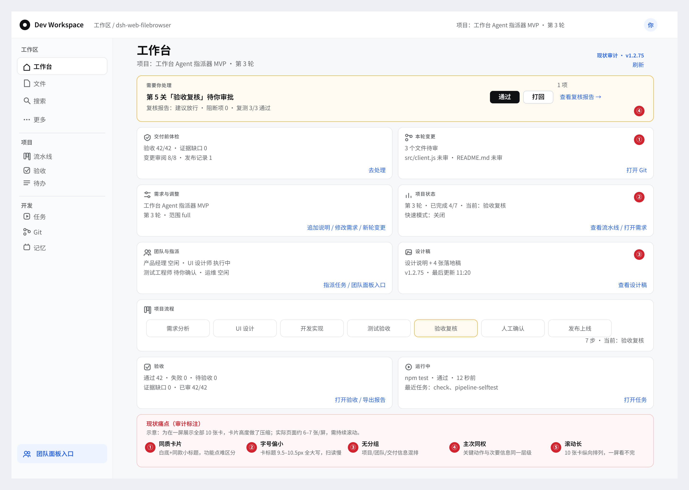
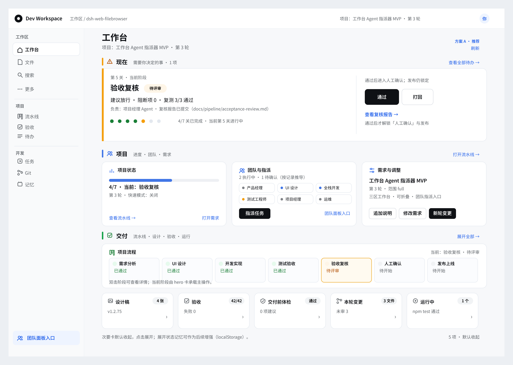
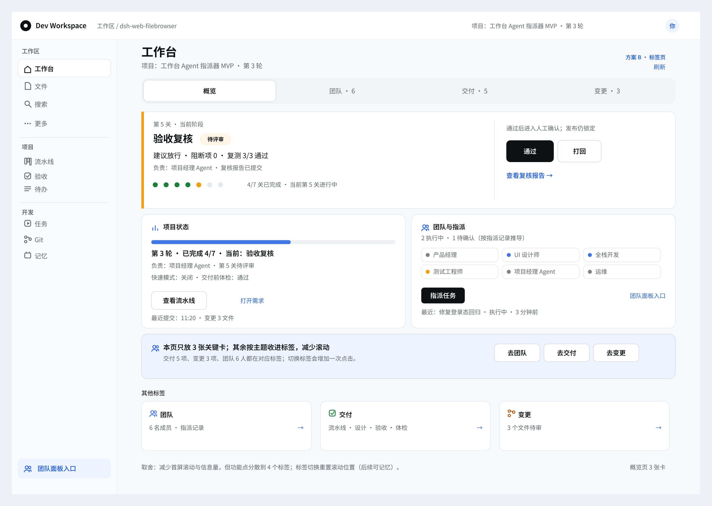
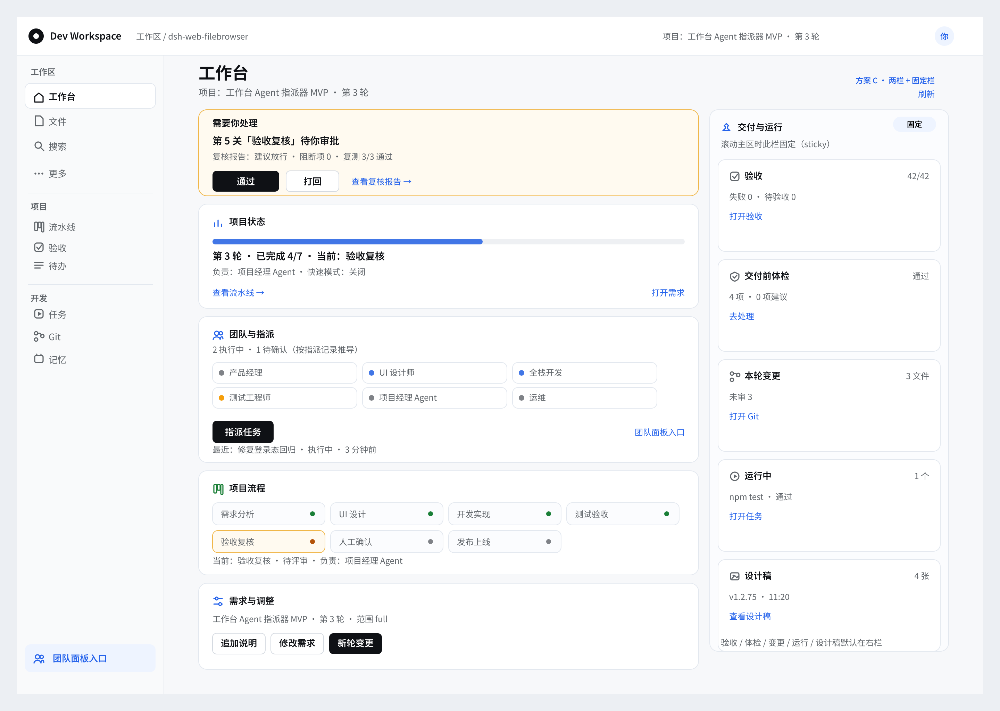

# 工作台 UI 重构提案（v1.2.76 候选）

> 角色：UI 设计师（`opc-design`）｜日期：2026-10-27｜状态：**提案（不实现）**，供 Owner 选方向
> 输入：用户反馈「工作台看的太累、区分不出功能点」；现状 `renderWorkbenchPage`（client.js ≈17540）+ `.ds-wb-*` CSS（≈24356–24470）；设计标准见 [docs/pipeline/design.md](../../pipeline/design.md)（v1.2.73 硬标准）。
> 交付：`before` 现状审计 + 3 套候选方案（A 推荐 / B 标签页 / C 两栏固定栏），全部 1440×1024 浅色、中文可读、sharp + Noto Sans SC 渲染。

---

## 0. 一页结论

| | 方案 | 一句话 | 结论 |
|---|---|---|---|
| A | **分区工作台** | 现在 / 项目 / 交付三区；hero 承载当前阶段与主操作；交付区次要卡默认收起 | **推荐**：首屏解决「现在该干嘛」，功能点按区识别，滚动大幅缩短 |
| B | **标签页** | 概览 / 团队 / 交付 / 变更 四 tab，每页 2–3 张卡 | 备选：滚动最少，但功能点分散、切换有成本 |
| C | **两栏 + 右侧固定栏** | 左主区 + 右侧 344px sticky 交付/运行栏 | 可作为 A 的增强：把验收/体检/变更/运行常驻右栏 |

**建议**：以 **A** 为主方向落地；若 Owner 希望「交付统计常驻可见」，在 A 的交付区右侧加 C 的 sticky rail（A+C 混合，见 §5）。B 仅在「更在意少滚动、不介意切页」时选择。

---

## 1. 现状痛点（before）



> 审计图说明：为在一屏展示全部 10 张卡，卡片高度做了压缩；实际页面约 6–7 张/屏，需要持续滚动。红线编号为审计标注，不是产品 UI。

| # | 痛点 | 证据（现状代码/样式） |
|---|---|---|
| ① | **同质卡片**：10 张卡全部白底+1px 边框+同款小标题，功能点难区分 | `.ds-wb-card` 单一背景/圆角；卡标题统一 `.ds-wb-card-title` |
| ② | **字号偏小**：卡标题 9.5–10.5px、全大写、letter-spacing，扫读慢 | `.ds-wb-card-title { font-size: 9.5px; text-transform: uppercase }`；`.ds-wb-page .ds-wb-card-title { 10.5px }` |
| ③ | **无分组**：项目状态、团队、需求、设计、验收、运行混排 | JSX 顺序 `issuesCard, attentionCard, preflightCard, reviewCard, adjustCard, requirementCard, flowCard, designCard, acceptanceCard, runningCard` |
| ④ | **主次同权**：关键动作（待处理/当前阶段/指派）与体检/变更/设计稿/运行同权 | 所有卡同网格、同视觉权重；仅 `ds-wb-attention` 有底色 |
| ⑤ | **滚动长**：2 列 1080px 网格，10 张卡纵向滚动 | `.ds-wb-page-inner` 2 列 + 卡片高度不齐；无折叠/分区 |

**目标**：关键动作 1 屏内可见；功能点按区/页可辨识；次要信息可收起；保持现有卡片内容、操作与 `ds-wb-*` 复用，不引入新依赖。

---

## 2. 三套方案

| 图 | 方案 | 布局 | 首屏关键动作 | 次要信息 |
|---|---|---|---|---|
| [A](mockups/option-a.png) | 分区工作台 | 现在 → 项目 → 交付 | hero 内：通过/打回/查看复核报告 | 交付区 5 张折叠卡 + 计数 |
| [B](mockups/option-b.png) | 标签页 | 概览 / 团队 / 交付 / 变更 | 概览页 hero 内 | 切到「交付/变更」标签 |
| [C](mockups/option-c.png) | 两栏 + 固定栏 | 左主区 + 右 344px sticky | 左上「需要你处理」卡 | 右栏常驻 5 张小卡 |

### 2.1 方案 A（推荐）：分区工作台



**结构**

```
工作台
├─ 现在（amber）      需要你决定的事 · 1 项
│   └─ hero：第 5 关 验收复核｜待评审｜建议放行 · 阻断项 0 · 复测 3/3
│        [通过] [打回] [查看复核报告]      4/7 关进度
├─ 项目（blue）       进度 · 团队 · 需求
│   ├─ 项目状态（进度 4/7 / 快速模式 / 链接）
│   ├─ 团队与指派（6 chips + 指派任务 + 团队面板入口）
│   └─ 需求与调整（需求标题 / 追加说明 / 修改需求 / 新轮变更）
└─ 交付（green）      流水线 · 设计 · 验收 · 运行
    ├─ 项目流程：7 步全宽（当前验收复核）
    ├─ 折叠卡 ×5：设计稿 4 张 / 验收 42/42 / 交付前体检 通过 / 本轮变更 3 文件 / 运行中 1 个
    └─ 默认收起 + 计数；展开状态后续记忆
```

**设计要点**

- 分区标题条：左侧 4px 类目色条 + 16px 图标 + 分区名（现在/项目/交付）+ 12px 副说明 + 右侧操作；一眼区分功能面。
- hero 卡：标题 20px、状态 pill、摘要 14px、7 点进度；主操作放在右上，**1 屏内可见**。
- 卡片：图标 16 + 标题 13px/600 + 说明 12px；内边距 16/20，圆角 12；间距 12/16，符合 4/8px 体系。
- 次要卡默认收起：仅显示图标/标题/计数/箭头；点击展开为完整卡（沿用现有 `ds-wb-*` 内容）。
- 折叠状态记忆：后续用 `localStorage`（key `dsh-web-filebrowser:wb-fold`），本提案不要求实现。

**取舍**：首屏信息密度高于 B，仍保留一屏可扫读；需要一次较大的 `renderWorkbenchPage` 重排（但卡片内部内容基本不动）。

### 2.2 方案 B：标签页



- Tab：概览 / 团队 6 / 交付 5 / 变更 3；概览页只放 3 张卡（hero + 项目状态 + 团队与指派）。
- 优点：滚动最少、每页聚焦；缺点：功能点分散、切换有额外点击与上下文丢失；跨标签的关联（如「待处理 → 团队」）需要跳转。
- 适合：Owner 更在意「少滚动、每页专注」，接受标签导航。
- 实现：需新增 `wbTab` 状态与 4 个页面片段；折叠需求少，但 tab 状态与移动端底部栏需额外适配。

### 2.3 方案 C：两栏 + 右侧固定栏



- 左 720px 主区：需要你处理（含主操作）→ 项目状态 → 团队与指派 → 项目流程（7 步两行）→ 需求与调整。
- 右 344px **sticky** 栏：交付与运行（验收 / 交付前体检 / 本轮变更 / 运行中 / 设计稿），主区滚动时固定。
- 优点：主区聚焦操作，右栏常驻交付统计；缺点：窄屏需降级（右栏转下移或折叠），sticky 在低高度屏幕可能占空间；实现与回归成本最高。
- 建议：不单独选 C；作为 **A 的增强**（A 的交付区右侧 sticky 化，或 ≥1280 才显示）。

---

## 3. 方案对比与推荐

| 维度 | A 分区工作台 | B 标签页 | C 两栏 + 固定栏 |
|---|---|---|---|
| 首屏信息密度 | 高（3 区 + hero + 5 折叠） | 低（1 页 3 卡） | 高（左 5 卡 + 右 5 卡） |
| 关键动作可见性 | ★★★★★（hero） | ★★★★☆（概览 hero） | ★★★★★（左上） |
| 功能点可辨识 | ★★★★★（分区+色条+图标） | ★★★★☆（标签） | ★★★★☆（左右分工） |
| 滚动长度 | 短（折叠后约 1 屏） | 最短（每页 1 屏） | 中（右栏固定，左栏仍滚动） |
| 实现成本 | 中（~300–420 行 client + 120–160 CSS） | 中低（~250–350 + 70–110） | 中高（~260–360 + 100–140） |
| 主要风险 | 大改布局的回归面 | 功能分散/切页成本 | sticky/窄屏适配 |
| 推荐度 | **★★★★★ 主方案** | ★★★☆☆ 备选 | ★★★★☆ 作为 A 增强 |

**推荐理由**：用户问题的根因是「层级扁平 + 主次同权 + 无分组」。A 直接解决：hero 把「现在该做什么」提到第一屏；分区把项目/交付/操作分开；折叠把次要信息降权。B 解决「少滚动」但不解决「功能点混」；C 解决「常驻统计」但实现与适配成本最高。

---

## 4. 与现有 `ds-wb-*` / token 的映射

### 4.1 组件复用

| 方案元素 | 复用现有类 | 新增类（仅增量） |
|---|---|---|
| 页面/内容网格 | `.ds-wb-page`、`.ds-wb-page-head`、`.ds-wb-page-scroll`、`.ds-wb-page-inner` | `.ds-wb-zones`（纵向分区栈，gap 16） |
| 卡片外壳 | `.ds-wb-card`、`.ds-wb-card-head`、`.ds-wb-card-title`、`.ds-wb-card-title-inline` | `.ds-wb-fold`（折叠态）、`.ds-wb-fold-head`、`.ds-wb-fold-count` |
| 分区头 | 复用标题/间距 token | `.ds-wb-zone`、`.ds-wb-zone-head`、`.ds-wb-zone-icon`、`.ds-wb-zone-bar`（4px 色条） |
| hero | 复用卡片底/按钮/status pill | `.ds-wb-hero`、`.ds-wb-hero-main`、`.ds-wb-hero-actions`、`.ds-wb-hero-progress` |
| 按钮/链接 | `.ds-btn`、`.ds-linkbtn`、`.ds-wb-btn`、`.ds-wb-link` | — |
| 项目状态 | `.ds-wb-progress`、`.ds-wb-dots`、`.ds-wb-fast` | — |
| 团队 chips | `.ds-wb-chip`、`.ds-wb-card`、`.ds-wb-actions` | `.ds-wb-member-chip`（或复用 `.ds-wb-chip` + dot） |
| 流程 | `.ds-wb-flow`、`.ds-wb-steps`、`.ds-wb-step*` | `.ds-wb-flow-compact`（A 的 7 步压缩） |
| 折叠卡 | `.ds-wb-card` + `.ds-wb-status-pill`/`.ds-wb-count` | `.ds-wb-fold` 系列 |
| B 标签 | 复用按钮/胶囊 | `.ds-wb-tabs`、`.ds-wb-tab`、`.ds-wb-tab[data-active]` |
| C 右栏 | `.ds-wb-card` 系列 | `.ds-wb-rail`、`.ds-wb-rail-inner`（position: sticky） |

### 4.2 Token / 规范

- 全部沿用 `--dsw-alias-*`：`bg-base/layer-1/layer-2`、`label-primary/secondary/caption`、`border-l1/l2`、`state-*`、`brand-primary`。
- 间距 4/8：分区间距 16、卡间距 12、卡内 16/20；4px 色条；圆角 12/10；标题 13/600、分区 16/700、hero 20/700、正文 14、元信息 12；正文对比度 ≥4.5:1（颜色 `#0f1115` / `#61666b` / `#2563eb` 等近似值见下）。
- 对比度（浅色）：主文字 18.9:1、次文字 5.8:1、链接 5.17:1、成功 4.66:1、警告 4.65:1、错误 4.79:1；不得用小字号语义色当正文（用 `*-text` 变体）。
- 状态不靠颜色：状态 pill/文字 + 圆点；分区色条同时有文字分区名。

---

## 5. 实现拆分（纯 client.js / CSS / i18n，不动 Host）

> 仅提案估算，实际以开发拆解为准；不变更 Host 接口、数据模型或依赖。

| 方案 | client.js | CSS | i18n | 说明 |
|---|---|---|---|---|
| **A** | **~300–420 行**（重排 `renderWorkbenchPage`、分区头/hero/折叠卡、`foldOpen` 状态与 a11y） | **~120–160 行** | **~16–22 键**（zone 名/副标题/折叠/计数/hero 标签） | 卡片内部内容复用现有渲染片段，主要改外层结构 |
| B | ~250–350 行（`wbTab` 状态 + 4 个页面分支 + 概览 3 卡） | ~70–110 行 | ~12–18 键（tab 名/计数/空页） | 移动端 tab 需底部栏适配 |
| C | ~260–360 行（两栏容器 + rail 排序） | ~100–140 行 | ~10–14 键（rail 标题/固定提示） | sticky + 窄屏降级最复杂 |
| A+C 混合 | ~340–460 行 | ~150–190 行 | ~18–24 键 | 建议作为 A 的后续增强，而非本轮一次做完 |

- 复用现有卡片渲染：`attentionCard/preflightCard/reviewCard/adjustCard/requirementCard/assignmentCard/flowCard/designCard/acceptanceCard/runningCard` 的**内容**不动，只改容器/顺序/折叠壳。
- 新增状态：`foldOpen`（A，Set<string>，可记忆）、`wbTab`（B）、`railOpen`（C/窄屏）。不新增全局 store。
- i18n 前缀建议 `workbench.zone.*` / `workbench.fold.*` / `workbench.tabs.*` / `workbench.rail.*`；中英同批补齐。
- 响应式：A ≥1024 三区；≤1024 分区仍纵向；≤768 单列、折叠卡两列变一列、hero 按钮换行；B tab 改底部/横向滚动；C 右栏 ≤1024 下移或收进「更多」。
- 不新增依赖；不需要 Host 改造；`npm run check` / `npm test` 回归；如后续加折叠记忆用 `localStorage`。

### 5.1 建议实现顺序（A）

1. 只做「分区头 + A 的三段容器」：把现有 10 张卡按 zone 归位，CSS 增量，先不大改卡片内容（可先不做折叠）。
2. 加 hero 取代「需要你处理 + 项目状态」重复信息：保留原卡数据来源，只重排视觉。
3. 交付区折叠：5 张次要卡默认收起，点击展开；更新 i18n 与键盘可达。
4. 响应式/深色/键盘/对比度复测；可选加 A+C sticky rail（≥1280）。
5. 文档同步（PLAYBOOK/AGENT_TEAM 不涉及 Host；仅 README/CHANGELOG/ACCEPTANCE）。

---

## 6. 验收要点（给实现后测试）

1. **首屏关键动作**：1440×1024 下，当前阶段主操作（通过/打回/启动/指派）在首屏可见，无需滚动。
2. **分区可辨识**：现在/项目/交付三区各有色条+图标+16px 标题；不靠颜色也能从标题读出分区。
3. **折叠**：5 张次要卡默认收起且显示计数；点击/键盘可展开；展开后内容与现有卡一致；折叠状态记忆（若实现）刷新后保留。
4. **内容不丢**：10 张现有卡（需要你处理/交付前体检/本轮变更/需求与调整/项目状态/团队与指派/项目流程/设计稿/验收/运行中）全部可达，操作不回归。
5. **响应式**：360 / 768 / 1280 无横向溢出；hero/按钮/chips 换行合理；B tab 在小屏可用；C rail 在窄屏降级。
6. **无障碍**：Tab 顺序与视觉顺序一致；折叠头是 button 且有 `aria-expanded`；焦点可见；对比度达标；不靠颜色单独表意。
7. **i18n**：中英文补齐，无 key 缺失；卡名沿用现有中文（需要你处理/项目状态/团队与指派/项目流程/设计稿/验收/运行中/交付前体检/本轮变更/需求与调整）。
8. **回归**：`npm run check`、`npm test`、pipeline/review selftest 通过；现有工作台/流水线/验收/团队指派功能不变；无新增依赖。

---

## 7. 风险与待定

| # | 风险/待定 | 影响 | 缓解 |
|---|---|---|---|
| 1 | `renderWorkbenchPage` 是 ~1000 行大函数，重排回归面大 | 改一处坏一处 | 分步落地（先分区容器→hero→折叠）；保留原卡片渲染片段；逐卡对照回归 |
| 2 | 折叠隐藏信息 | 可发现性下降 | 折叠头显示计数+摘要；默认展开关键卡；允许「展开全部」；后续记忆展开状态 |
| 3 | A/B/C 偏好未定 | 返工 | 本提案不动代码；Owner 选定后走七阶段；A 为主、C 可增量 |
| 4 | 分区色条/图标新增视觉元素 | 与现有风格冲突 | 只用 token 色 + 线性图标；不引入新组件库；深浅主题双测 |
| 5 | B 标签状态与移动端底部栏 | 额外适配 | 若选 B，先做桌面 + 底部 tab；保留旧布局可回退 |
| 6 | C sticky 在低高度屏占空间 | 移动端可用性 | ≤1024 右栏下移/折叠；`position: sticky` 加 `top` 约束；不用固定 footer |
| 7 | 折叠状态记忆未实现 | 每次刷新回到默认 | 作为后续增强（localStorage），验收不阻断 |
| 8 | 历史文档/截图与新布局不一致 | 误判 | 实现后同步 README/ACCEPTANCE；本提案保留 before 作为对照 |

---

## 8. 资源与自检

| 文件 | 内容 | 尺寸 |
|---|---|---|
| [mockups/before.svg](mockups/before.svg) / [before.png](mockups/before.png) | 现状 10 卡 + 5 处痛点审计标注（含压缩说明） | 1440×1024 / 2880×2048 |
| [mockups/option-a.svg](mockups/option-a.svg) / [option-a.png](mockups/option-a.png) | 方案 A 分区工作台（推荐） | 同上 |
| [mockups/option-b.svg](mockups/option-b.svg) / [option-b.png](mockups/option-b.png) | 方案 B 标签页 | 同上 |
| [mockups/option-c.svg](mockups/option-c.svg) / [option-c.png](mockups/option-c.png) | 方案 C 两栏 + sticky 右栏 | 同上 |

**渲染自检**：sharp(librsvg) + Noto Sans SC 400/600/700，@144dpi → 2880×2048；4 张 PNG 均能打开、中文无豆腐块、无文字溢出；浅色主题；关键色对实测对比度见 §4.2；本地链接可用。
**取舍说明**：`before` 为在一屏展示全部 10 张卡做了高度压缩（真实页面约 6–7 张/屏）；after 均按真实内容层级绘制，未压缩关键信息。

---

## 9. 与 v1.2.75 的衔接

- 团队与指派（v1.2.75）在方案 A 中归入「项目」区，保留成员 chips/指派入口/团队面板入口；在 B 中归入「团队」tab；在 C 中归入左主区。
- 指派状态卡/抽屉/空态不在本次重构范围；重构后入口位置变化，但交互与 API 不变。
- 下一轮若选 A，建议作为 v1.2.76 的完整七阶段交付；本文件只做方向选择，不进入实现。
